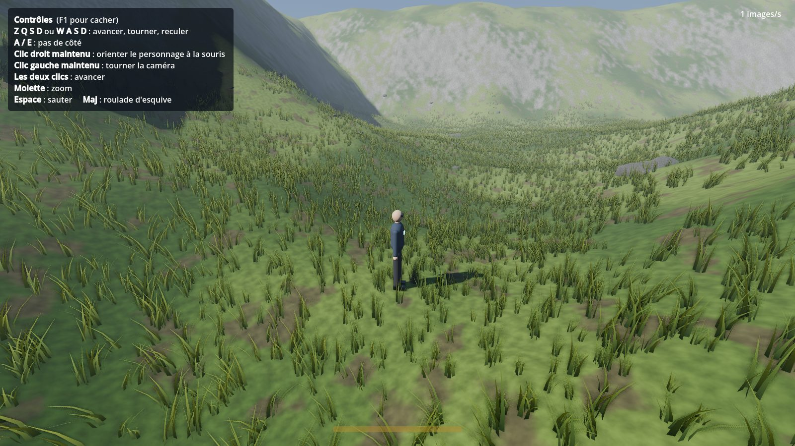

# SickWorld

MMORPG en 3D (vue à la troisième personne) où le joueur incarne un voyageur temporel chargé de réparer l'histoire, île après île, époque après époque.

- Moteur : Godot 4.7
- Outils : Blender, MakeHuman, Poly Haven, Mixamo, Fab (100 % gratuits)

## Organisation du dépôt

```
docs/      Documents de conception et guides pas à pas
game/      Le projet Godot (ouvrir game/project.godot)
  assets/    Modèles 3D, textures, sons, animations
  data/      Données de jeu (compétences, quêtes, objets)
  scenes/    Les zones, le personnage, l'interface
  scripts/   Le code (GDScript)
  shaders/   Les matériaux programmés (herbe, terrain…)
  tests/     Tests automatiques
```



## Documentation

- [Document de conception (GDD)](docs/GDD.md)
- [Ouvrir et tester le projet](docs/guides/ouvrir-et-tester-le-projet.md)
- [Créer son personnage](docs/guides/creer-son-personnage.md)
- [Créer le personnage avec MakeHuman et Mixamo](docs/guides/personnage-makehuman-mixamo.md)
- [Régler le combat sans coder](docs/guides/regler-le-combat.md)
- [Jouer à plusieurs](docs/guides/jouer-a-plusieurs.md)
- [Visiter la Préhistoire : la Côte Gelée](docs/guides/visiter-la-prehistoire.md)
- [La carte (mini-carte, brouillard, repères)](docs/guides/la-carte.md)

## Tests automatiques

```
godot --headless --path game -s res://tests/test_deplacement.gd
godot --headless --path game -s res://tests/test_combat.gd
godot --headless --path game -s res://tests/test_creation_personnage.gd
godot --headless --path game -s res://tests/test_hub.gd
godot --headless --path game -s res://tests/test_intro.gd
godot --headless --path game -s res://tests/test_cote_gelee.gd
godot --headless --path game -s res://tests/test_quetes.gd

# Multijoueur : un serveur dédié puis un ou plusieurs clients de test
godot --headless --path game -- --serveur --colline --port=7790
godot --headless --path game -s res://tests/test_reseau.gd -- --port=7790 --nom=Alice
```
