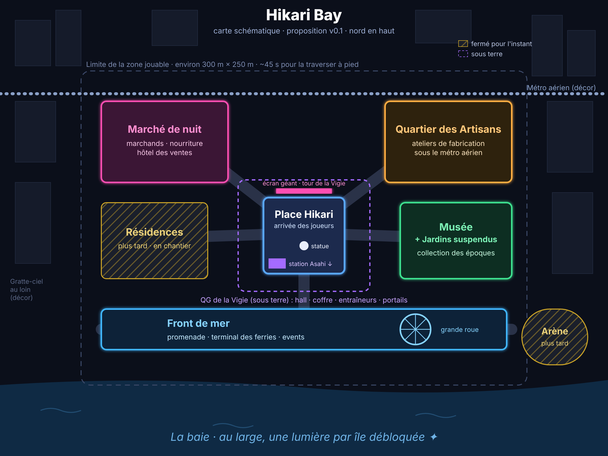

# Plan du hub : Hikari Bay

*Version 0.2 du 13 novembre 2026, validée par Gaël. Complète la section 3 du [GDD](GDD.md).*

## 1. En bref

**Hikari Bay** est la ville moderne où les joueurs se retrouvent entre deux aventures. C'est une zone **sûre** (pas de combat), de nuit, sous une pluie fine, inspirée de Tokyo et de Singapour.

Le plan propose une ville **compacte** : une grande place centrale, quatre quartiers autour, un front de mer, et le **QG secret de la Vigie** caché sous une station de métro abandonnée. Ce qui est prévu « plus tard » (résidences, arène) est déjà placé sur la carte mais fermé par des barrières de chantier : on pourra l'ouvrir sans redessiner la ville.

## 2. Taille et principes

| Principe | Proposition | Pourquoi |
|---|---|---|
| **Taille jouable** | Environ **300 m × 250 m** (comme 3 terrains de foot sur 2). Traverser la ville à pied prend **45 secondes** environ. | Assez grand pour qu'on s'y sente dans une métropole, assez petit pour qu'un développeur seul le remplisse avec soin. Un hub où l'on marche longtemps pour rien lasse vite. |
| **Ville « vue de l'intérieur »** | On ne marche que dans quelques rues, mais les gratte-ciel autour sont visibles au loin (façades simples, non visitables). | C'est l'astuce des grands jeux : l'impression d'immensité coûte peu si les décors lointains sont simples. |
| **Ambiance** | Nuit permanente, pluie légère, néons bleus et roses, reflets sur le sol mouillé, beaucoup de verdure (arbres, jardins suspendus). | Conforme à la palette du GDD, très reconnaissable, et la nuit cache bien les détails lointains (moins de travail, meilleures performances). |
| **Zone sûre** | Pas de combat. Les joueurs peuvent courir, sauter, s'asseoir, discuter. | Le hub sert à se retrouver et se préparer. |
| **Repères visibles de partout** | L'écran géant de la place, la tour de la Vigie (déguisée en immeuble de bureaux), la grande roue du front de mer. | On ne se perd jamais : on se repère à ces trois silhouettes. |

## 3. Les lieux, un par un

### La Place Hikari (centre)

Le cœur de la ville et le point d'arrivée des joueurs.

- Grande place piétonne dallée, environ 60 m × 60 m, avec des bancs, des arbres et une fontaine.
- **L'écran géant** sur la façade nord : publicités, et en secret les nouvelles du serveur (taux de stabilité des époques, events en cours).
- **La statue du Gardien** au centre : c'est elle qui « s'abîme » quand l'histoire va mal (voir la ville qui change).
- **L'entrée de la station Asahi**, fermée au public depuis des années : un escalier condamné par une grille... que les agents de la Vigie peuvent franchir. C'est l'entrée du QG.
- **Le tableau des missions** (avis de recherche, events) près de la station.

### Le Marché de nuit (nord-ouest)

L'esprit Tokyo : trois ruelles étroites (4 à 6 m), lanternes, fumée des stands, enseignes lumineuses empilées.

- **Marchands** d'équipement et de consommables.
- **Stands de nourriture** : chaque plat donne un bonus temporaire (ramen = vie, brochettes = endurance...).
- **L'hôtel des ventes** : une petite salle de « paris clandestins » reconvertie, où les joueurs vendent et achètent entre eux.

### Le Quartier des Artisans (nord-est)

D'anciens entrepôts sous la ligne de **métro aérien**, transformés en ateliers.

- Ateliers de fabrication (forge moderne, établi, imprimante 3D, couture).
- On y transforme les matériaux rapportés des époques (silex, ivoire, fourrures...).
- Le métro aérien passe au-dessus avec bruit et lumière toutes les 2 minutes (décor).

### Le Musée et les Jardins suspendus (est)

L'esprit Singapour : un bâtiment de verre entouré de jardins en terrasses.

- **Le Musée** : la collection d'objets historiques récupérés par les joueurs (vénus, flûte en os, lampe à graisse...), visible par tous.
- Une salle par époque. La salle Préhistoire contient les **fresques** qui s'effacent puis reviennent.
- **Les Jardins suspendus** : passerelles, cascades, un lieu calme pour se poser.

### Le Front de mer (sud)

La baie qui donne son nom à la ville.

- Une promenade le long de l'eau, la **grande roue**, des bateaux à quai.
- **Le Terminal des ferries** : façade officielle de la Vigie (une compagnie maritime). Les îles-époques sont « symboliquement » au large : de nuit, on voit au loin des lumières étranges sur l'horizon, une par île débloquée.
- Lieu idéal pour les events de serveur (fêtes, rassemblements).

### Plus tard (placés mais fermés)

- **Les Résidences** (ouest) : appartements personnels et sièges de guildes. Barrières de chantier « Bientôt ».
- **L'Arène** (sud-est, au bord de l'eau) : un stade en rénovation, pour le JcJ.

## 4. Le QG de la Vigie (sous la place)

On y descend par l'escalier de la station Asahi. C'est un lieu à part (intérieur), sur le même serveur que la ville.

| Salle | Rôle |
|---|---|
| **Le quai abandonné** | Ancienne station de métro, carrelage, affiches des années 80. Un faux mur s'ouvre devant les agents. |
| **Le Hall des opérations** | Grande salle avec écrans et carte du monde. La **commandante** de la Vigie y donne les quêtes principales. |
| **Le Coffre** | La banque : chaque joueur y range ses objets. |
| **La Salle d'entraînement** | Les entraîneurs de compétences (un par classe : Rempart, Lame, Traqueur, Tisseur). |
| **La Salle des portails** | Un grand anneau par époque. Seul celui de la Préhistoire est allumé pour l'instant ; les autres sont éteints, couverts de bâches. Le traverser = voyager vers l'île (changement de serveur avec écran de chargement). |

## 5. La ville qui change (Préhistoire)

Tant que la Préhistoire est malade :
- **Les chiens ont disparu des rues** (aucun chien dans toute la ville, des affiches « chien perdu » partout) ;
- **Les fresques du musée sont vides** ;
- la **statue du Gardien** est fissurée et entourée d'éclats violets-cyan (la signature des fractures).

Quand les joueurs du serveur réparent l'époque (taux de stabilité), les chiens reviennent, les fresques réapparaissent et la statue se répare. Techniquement : chaque élément « malade » ou « soigné » est un interrupteur que le serveur active selon le taux de stabilité.

## 6. Comment on le construit

1. **La maquette en blocs (« blockout »)** : je construis d'abord la ville avec des formes simples (boîtes, cylindres), aux bonnes dimensions. On s'y promène pour vérifier les distances, les repères et le plaisir de marcher, avant de dépenser du temps en jolis décors.
2. **Un « kit » de construction modulaire** : façades, trottoirs, lampadaires, enseignes, stands... que l'on assemble comme des Lego. On les prend en priorité sur **Fab** et **Poly Haven** (gratuits), on les ajuste dans **Blender**, et les textures peuvent être retouchées avec **Substance** (Adobe).
3. **L'habillage, quartier par quartier** : on remplace les blocs par le kit, on ajoute la lumière, la pluie, les néons, les sons.
4. **La technique** : le hub est une scène Godot séparée de l'île, découpée en sous-scènes par quartier (plus facile à faire évoluer), avec des modèles simplifiés au loin et du « masquage » des bâtiments cachés pour garder un bon nombre d'images par seconde, même avec beaucoup de joueurs.

**Licences :** chaque ressource utilisée est notée dans `docs/CREDITS.md`. Les fichiers lourds iront dans Git LFS.

## 7. Premier quartier jouable proposé

**La Place Hikari + l'entrée de la station Asahi**, en maquette de blocs d'abord, puis habillée :
- la place, ses repères (écran géant, statue, fontaine, arbres) et les rues qui en partent (fermées pour l'instant) ;
- la nuit, la pluie et les premiers néons ;
- l'escalier de la station, qui mène pour l'instant à une porte « QG en construction ».

C'est le point d'arrivée des joueurs et l'endroit le plus visité : c'est lui qui doit donner le ton. Le QG et la salle des portails suivront (étape 6 du prototype : départ du hub vers la Préhistoire).

## 8. Décisions de Gaël (13 novembre 2026)

1. **Le joueur commence en ville** par une courte introduction d'environ 5 minutes : il est recruté, descend au QG de la Vigie par la station Asahi, puis passe le portail vers la Préhistoire.
2. **Nuit permanente** pour commencer (un cycle jour/nuit pourra venir plus tard).
3. **Enseignes en japonais, anglais et français mélangés.**
4. **Claude construit les décors**, en style réaliste ; Gaël les juge en jouant.
