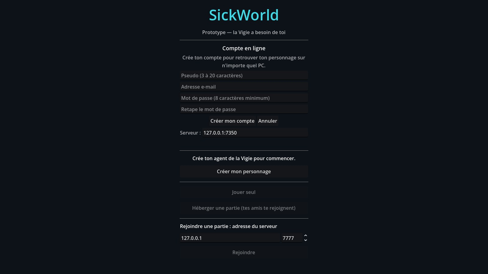

# Compte en ligne et sauvegarde sur le serveur

Depuis le 14/11/2026, SickWorld peut garder ton personnage sur un **serveur de comptes**
(Nakama, gratuit et libre). Avec un compte, tu retrouves ton agent, ton inventaire,
tes quêtes, ta carte, ton appartement et ta guilde sur n'importe quel PC.

**Le compte est facultatif.** Sans compte, ou si le serveur est éteint,
« Jouer seul » marche exactement comme avant : tout reste sur ton PC.

## Allumer le serveur sur ton PC

Le serveur est installé dans `Documents\SickWorld_serveur` (Nakama + sa base PostgreSQL).

1. Double-clique sur `serveur\windows\demarrer_serveur.bat` (dans le dossier SickWorld).
2. Une fenêtre noire s'ouvre : **laisse-la ouverte** pendant que tu joues.
3. Pour l'éteindre : ferme la fenêtre, ou double-clique sur `arreter_serveur.bat`.

Première installation sur un autre PC : clic droit sur `serveur\windows\installer_serveur.ps1`
> « Exécuter avec PowerShell » (télécharge Nakama et PostgreSQL, environ 300 Mo, sans droits administrateur).

## Dans le jeu

- **Créer un compte** : pseudo, e-mail, mot de passe (8 caractères minimum).
  Si tu avais déjà un personnage hors ligne, il est **copié** dans ton nouveau compte.
- **Se connecter** : e-mail + mot de passe. Le jeu se souvient de toi pendant 30 jours
  (le mot de passe n'est jamais enregistré sur le PC).
- Pendant le jeu, la sauvegarde part sur le serveur **toutes les 20 secondes** et quand tu fermes le jeu.
  Le menu indique « Sauvegardé en ligne à 23:41 ».
- **Se déconnecter** : retour à ton personnage hors ligne.
- Si le serveur ne répond pas, le jeu continue normalement et réessaie tout seul plus tard.

La console d'administration de Nakama (voir les comptes, les sauvegardes) :
<http://127.0.0.1:7351>, identifiant `admin`, mot de passe dans `serveur/nakama/config.yml`.

## Comment c'est rangé (pour les curieux)

Chaque profil a son dossier sur le PC (dans les données de Godot, `user://profils/`) :

| Dossier | Contenu |
|---|---|
| `profils/hors_ligne/` | ton personnage sans compte |
| `profils/compte_<numéro>/` | la copie locale d'un compte |

Dedans : `personnage.json` (création), `progression.cfg` (intro, quêtes, Préhistoire, guilde),
`sauvegardes/inventaires/` (sacs, équipement, tenues), `cartes/` (brouillard de la carte).
Sur le serveur, chaque fichier est une « boîte » de la collection `sauvegarde` du joueur.

Pour les développeurs : toute nouvelle sauvegarde du personnage doit s'ouvrir avec
`Profil.chemin("user://…")` et son nom doit figurer dans `Profil.FICHIERS` ou `Profil.DOSSIERS`
(`game/scripts/personnage/profil.gd`). Les réglages du PC (graphismes, adresse du serveur) restent hors profil.

## Ce qui viendra ensuite

- En multijoueur, le serveur de jeu Godot vérifiera le compte de chaque joueur et écrira
  lui-même les sauvegardes (aujourd'hui c'est le jeu du joueur qui les envoie : suffisant
  pour le prototype, pas contre la triche).
- Hébergement sur Oracle Cloud (gratuit) : changer les clés « À CHANGER » de
  `serveur/nakama/config.yml` et la `CLE_SERVEUR` de `game/scripts/autoload/compte.gd`, puis
  mettre l'adresse du serveur dans le menu (champ « Serveur »).

Test automatique : `godot --headless --path game -s res://tests/test_compte.gd -- --adresse=127.0.0.1:7350`
(sans serveur, seule la partie hors ligne est testée).
