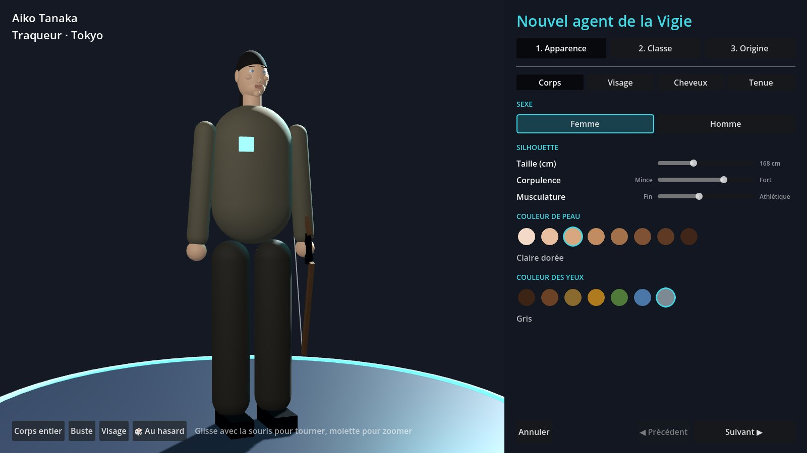
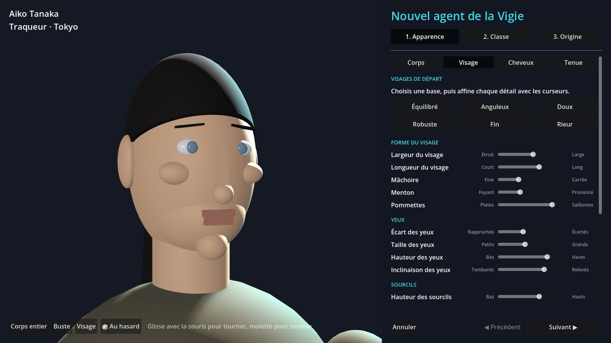
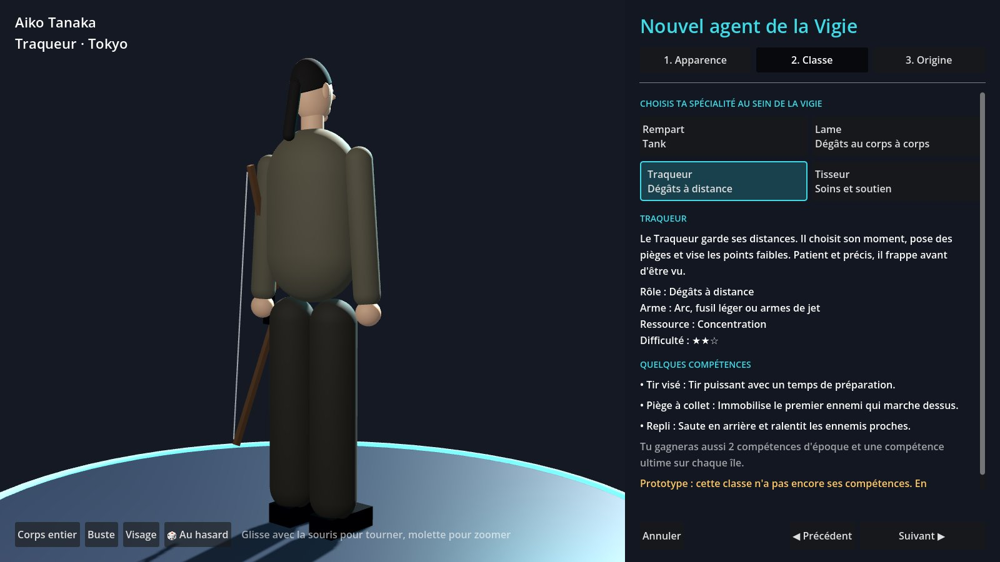
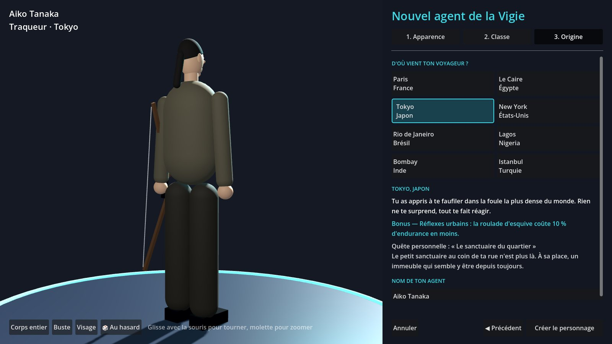

# Créer son personnage

Au premier lancement, le menu affiche **« Crée ton agent de la Vigie pour commencer »**. Les boutons pour jouer restent grisés tant que tu n'as pas de personnage.

Clique sur **Créer mon personnage**. L'écran se fait en 3 étapes (boutons en haut à droite, ou **Suivant ▶** en bas).

## 1. Apparence

Quatre onglets :

- **Corps** : femme ou homme, taille, corpulence, musculature, couleur de peau et des yeux.
- **Visage** : choisis un visage de départ (Équilibré, Anguleux, Doux…), puis règle chaque détail avec les 17 curseurs. La caméra zoome toute seule sur le visage.
- **Cheveux** : coiffure, couleur, barbe et moustache.
- **Tenue** : les trois tenues de départ de la Vigie.

À gauche, l'aperçu : **glisse avec la souris** pour faire tourner le personnage, **molette** pour zoomer, ou les boutons *Corps entier / Buste / Visage*. Le bouton **🎲 Au hasard** tire un personnage complet.

> **Le vrai personnage.** L'écran montre maintenant le personnage réaliste MakeHuman (homme ou femme). Les 17 curseurs du visage déforment vraiment son visage, et la peau, les yeux, les cheveux, la barbe et la couleur de la tenue suivent tes choix. Les 10 coiffures (rasé, très courte, courte, courte en bataille, mi-longue, carré, longue, queue de cheval, tresse, afro) sont de vrais modèles MakeHuman, ajustés à chaque tête.

## 2. Classe

Choisis l'une des 4 spécialités de la Vigie. À droite : son rôle, son arme, sa ressource, sa difficulté et quelques compétences. Le personnage montre l'arme de la classe et fait un mouvement de temps en temps.

Dans ce prototype, seule la **Lame** a déjà ses vraies compétences. Les trois autres jouent avec celles de la Lame en attendant (c'est écrit en orange sous la classe).

## 3. Origine et nom

Choisis la ville d'où vient ton voyageur. Chaque ville donne un **petit bonus** (en bleu) et une **quête personnelle** qui sera ta première mission. Les bonus de Tokyo, New York et Rio marchent déjà ; les autres s'activeront quand le système correspondant existera (réputation, marchands…).

Tape enfin le **nom** de ton agent (3 à 20 lettres ; espaces, tirets et apostrophes permis) et clique sur **Créer le personnage**.

## Ensuite

Retour au menu : ton personnage y est résumé (nom, classe, ville). **Modifier mon personnage** rouvre l'écran avec tes réglages. En jeu, les autres joueurs voient ton apparence, ta tenue et ton arme.

Le personnage est enregistré sur ton PC (fichier `personnage.json` dans le dossier de données de Godot : *Projet > Ouvrir le dossier de données utilisateur*). Quand les comptes arriveront (étape 4), il sera rangé sur le serveur.

## Changer les choix proposés (sans coder)

Tout est dans **`game/data/creation_personnage.json`** : ouvre-le avec le Bloc-notes (ou dans Godot) pour :

- renommer une coiffure, une couleur, une tenue ;
- changer une couleur (code `#RRVVBB`, par exemple `#a8501f` pour le roux) ;
- réécrire la description d'une classe, d'une ville ou d'une quête personnelle ;
- ajouter une ville ou une coiffure (copie un bloc existant, change son `id`).

Attention : ne change pas un `id` qui existe déjà, sinon les personnages déjà créés retrouvent le choix par défaut. Si le jeu affiche une erreur au lancement, il manque sûrement une virgule ou un guillemet.
