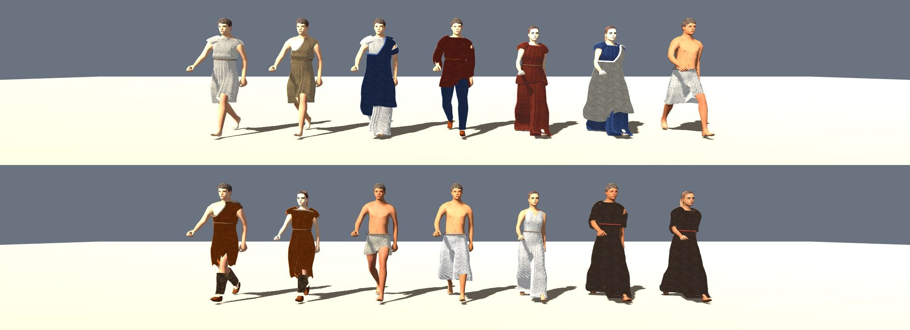

# Les habits d'époque

Les habitants des îles (figurants, PNJ, Oubliés, Pétrifiés, Masqués) ne portent plus la
veste et le jean du personnage de base : ils ont de vrais vêtements de leur époque, qui
suivent toutes les animations (marcher, s'asseoir, creuser, prier…).

## Les 14 habits

| Habit | Pour | Île |
|---|---|---|
| `chiton_court` | homme | Grèce : tunique courte ceinturée (marins, gardes) |
| `exomis` | homme | Grèce : tunique attachée sur une épaule (dockers, rameurs, mineurs) |
| `chiton_himation` | homme | Grèce : chiton long + manteau drapé (citoyens, Socrate, marchands) |
| `scythe` | homme | Grèce : archer scythe (tunique à manches, pantalon, chaussures) |
| `peplos` | femme | Grèce : péplos à rabat, ceinturé |
| `peplos_himation` | femme | Grèce : péplos + manteau drapé (Aspasie, prêtresse) |
| `shendyt` | homme | Égypte : pagne de lin plissé au genou |
| `shendyt_court` | homme | Égypte : pagne court (ouvriers, haleurs, bateliers) |
| `shendyt_long` | homme | Égypte : pagne long (scribes, Ânkhkhaf, Hémiounou) |
| `kalasiris` | femme | Égypte : robe-fourreau de lin, encolure en V |
| `robe_nomade` | homme, femme | Désert : robe de laine à manches, sandales |
| `peaux` | homme | Préhistoire : tunique de cuir sur une épaule, fourrure, jambières, mocassins |
| `peaux_femme` | femme | Préhistoire : robe de cuir, fourrure, jambières, mocassins |

## Changer l'habit d'un personnage

Dans `data/vie_ambiante.json` (rubrique `modeles_figurants`) ou dans
`data/<île>_pnj.json`, chaque personnage peut avoir :

- `"habit": "chiton_court"` : le nom de l'habit (voir le tableau) ;
- `"habits": "#e4dac4"` : la couleur principale du tissu ;
- `"antique": {"drape": "#3a4a6a", "ceinture": "#6a4a30"}` : couleur du manteau drapé et
  de la ceinture (facultatif) ;
- `"couleurs": {"fourrure": "#8a6a4a", "chaussures": "#6a4a32"}` : autres couleurs
  (facultatif).

Sans `habit` (les agents de la Vigie, Vera Lind, Damien Roche), le personnage garde sa
tenue moderne. Les objets de `tenue` (bandeau, collier ousekh, cape, capuche…) se portent
par-dessus l'habit.

## Comment ils sont fabriqués

Tout est gratuit et refait par programme, sans retouche à la main :

1. **Corps sans vêtements** : MakeHuman (CC0) refait les deux corps (même morphologie que
   l'agent) sans habits : `tools/personnages/corps_nus/`.
2. **Couture** : `tools/personnages/habits_epoque.py` (Blender 5.2 ou le module Python
   `bpy`, avec numpy et scipy) donne au corps nu les poids d'os du squelette Mixamo, puis
   coud chaque pièce autour du corps (tranches + enveloppe : le tissu passe par-dessus
   les creux), avec plis, évasement, blousant à la ceinture, ourlets épais, et retire la
   peau cachée sous le tissu. Les recettes sont en bas du fichier (`CATALOGUE`).
3. **Textures** : `tools/personnages/textures_tissus.py` calcule le lin, la laine et la
   fourrure (tuilables, en gris, teintées dans le jeu). Le cuir est la texture Poly Haven
   `brown_leather` (CC0) déjà dans le projet.
4. **Conversion Godot** :
   `godot --headless --path game -s ../tools/personnages/habits_vers_godot.gd`
   écrit `game/assets/personnages/vetements/<sexe>/<habit>.res`.

Dans le jeu : `scripts/personnage/habit_epoque.gd` (et `apparence_agent.porter_habit()`).

## Vérifier

`godot --path game -s res://tests/capture_habits.gd -- planche.jpg marcher 0.3`
(fenêtre visible) fait une planche de tous les habits ; on peut choisir l'animation
(`immobile`, `marcher`, `assis`, `creuser`, `a_genoux`…) et la liste
(`chiton_court:homme peplos:femme`).

## Limites connues

- Les formes du visage (curseurs de l'écran de création) ne s'appliquent pas à un
  personnage en habit d'époque (son corps vient d'un autre maillage).
- De très près, un petit jour peut apparaître à la racine d'une manche quand le bras se
  lève, et une cuisse peut toucher l'ourlet d'une tunique courte en pleine foulée.
