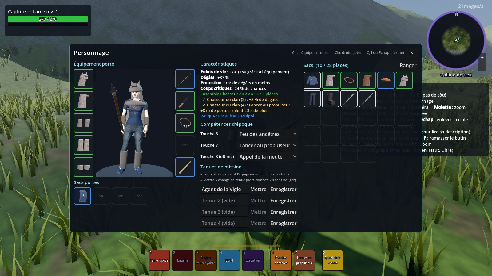

# Inventaire, équipement et tenues de mission

Ce guide explique comment essayer l'inventaire dans le prototype, et comment changer les objets sans coder.

## Essayer en jeu

1. Lance le jeu (bouton ▶ de Godot), puis **Jouer seul**.
2. Appuie sur **C** (ou **I**, ou **B**) : l'écran **Personnage** s'ouvre.
   - **À gauche** : ton personnage en 3D, entouré de ce qu'il porte (armure à gauche, armes, bijoux et relique à droite). Il change dès que tu l'équipes. Glisse la souris dessus pour le faire tourner. En dessous, tes sacs portés.
   - **Au milieu** : tes caractéristiques, les ensembles actifs, tes compétences d'époque (touches 6, 7 et 8) et tes **tenues de mission**.
   - **À droite** : le contenu de tes sacs, chaque objet avec son image. Les couleurs des bords indiquent la rareté (blanc, vert, bleu, violet, orange), le chiffre en bas à droite la quantité.
3. **Clic** sur un objet des sacs : tu l'équipes (l'ancien revient dans le sac). **Clic** sur un emplacement porté : tu le retires. **Clic droit** sur un objet des sacs : tu le jettes (une confirmation est demandée).
4. Survole un objet pour lire ses bonus et ceux de son ensemble.

Au départ, tu portes la tenue de la Vigie, et tes sacs contiennent déjà quelques pièces de la Préhistoire pour essayer : la **capuche** et la **cape du chasseur**, le **bandeau** et le **manteau du gardien**, et la relique **Ocre sacrée**.

## Les tenues de mission (se changer)

1. Équipe ce que tu veux, et choisis tes compétences d'époque (touches 6 et 7) et ton ultime (touche 8) dans les listes.
2. Écris un nom dans une ligne vide (par exemple « Chasseur ») et clique sur **Enregistrer**.
3. Plus tard, clique sur **Mettre** : ton personnage se change en 2 secondes (hors combat, sans bouger), et ta barre de compétences change avec.

Tu ne peux pas changer d'équipement en plein combat (5 secondes sans coup donné ni reçu).

## Le butin

Va combattre les loups. Quand un loup meurt, **un petit sac lumineux** apparaît à côté de lui, **rien que pour toi** (chaque joueur a son propre butin). Approche-toi et appuie sur **F** pour le ramasser. Le sac disparaît au bout de 3 minutes.

Les loups donnent des crocs et des peaux (pour l'artisanat, plus tard), des pièces des ensembles **Chasseur du clan** et **Gardien du feu**, plus rarement la **lance à pointe de silex** ou une **besace** (8 places en plus), et très rarement une **relique**.

## Les ensembles d'époque

| Ensemble | 2 pièces | 4 pièces |
|---|---|---|
| **Chasseur du clan** | +8 % de dégâts | Lancer au propulseur : +8 m de portée, ralentit 3 s de plus |
| **Gardien du feu** | +40 points de vie | Feu des ancêtres : +1,5 m de rayon, soigne 2 fois plus |

Les **reliques** donnent une spécialisation : *Propulseur sculpté* (Lancer au propulseur se recharge 4 s plus vite), *Ocre sacrée* (Peinture de guerre dure 4 s de plus), *Dent de l'alpha* (les loups de l'Appel de la meute restent 10 s de plus).

Deux nouvelles compétences d'époque sont arrivées pour avoir le choix : **Cri du clan** (+15 % de dégâts pour toi et tes alliés proches pendant 10 s) et **Peinture de guerre** (30 % de dégâts en moins pendant 8 s).

## Changer les objets sans coder

Tout est dans le fichier `game/data/objets.json` (à ouvrir avec le Bloc-notes ou VS Code) :

- **`objets`** : chaque objet avec son nom, sa rareté, son emplacement, ses bonus (`stats`) et sa description.
- **`ensembles`** : les bonus à 2 et 4 pièces.
- **`butin`** : ce que lâche chaque ennemi. `chance` va de 0 (jamais) à 1 (toujours). Par exemple, mets `"chance": 1` sur la ligne des reliques pour en avoir une à chaque loup.
- **`depart`** : l'équipement et les objets d'un nouveau personnage.
- **`inventaire`** : taille du sac de départ, nombre de tenues, durée du changement de tenue.

Après une modification, relance le jeu. Attention aux virgules et aux guillemets : si le fichier est mal écrit, Godot l'indique en rouge dans la console.

## Les images des objets

Chaque objet a son image dans `game/interface/icones/` (un fichier PNG au nom de l'objet, par exemple `lance_silex.png`). Elles sont fabriquées automatiquement en photographiant la maquette 3D de l'objet. Tu peux remplacer n'importe laquelle par ta propre image (128 × 128 pixels, fond transparent) en gardant le même nom.

Quand on ajoute un objet, on refabrique les images avec `godot --path game -s res://tests/generer_icones.gd`. La forme utilisée est celle de `visuel` (ce qui se voit sur le corps) ou, à défaut, celle de `icone` dans `objets.json`.

## Recommencer avec un inventaire neuf

L'inventaire est enregistré par le serveur, un fichier par nom de personnage. Pour repartir de zéro, supprime le fichier qui porte le nom de ton personnage dans :
`%APPDATA%\Godot\app_userdata\SickWorld\sauvegardes\inventaires\`

## À savoir (prototype)

- Les pièces visibles sur le personnage (capuche, cape, lance…) sont des **maquettes en formes simples**, comme les blocs du hub. Elles seront remplacées par de vrais modèles 3D.
- La **garde-robe** (garder un look différent de ses statistiques) est prévue pour plus tard.
- La sauvegarde passera dans Nakama à l'étape 4 (comptes et sauvegarde).
