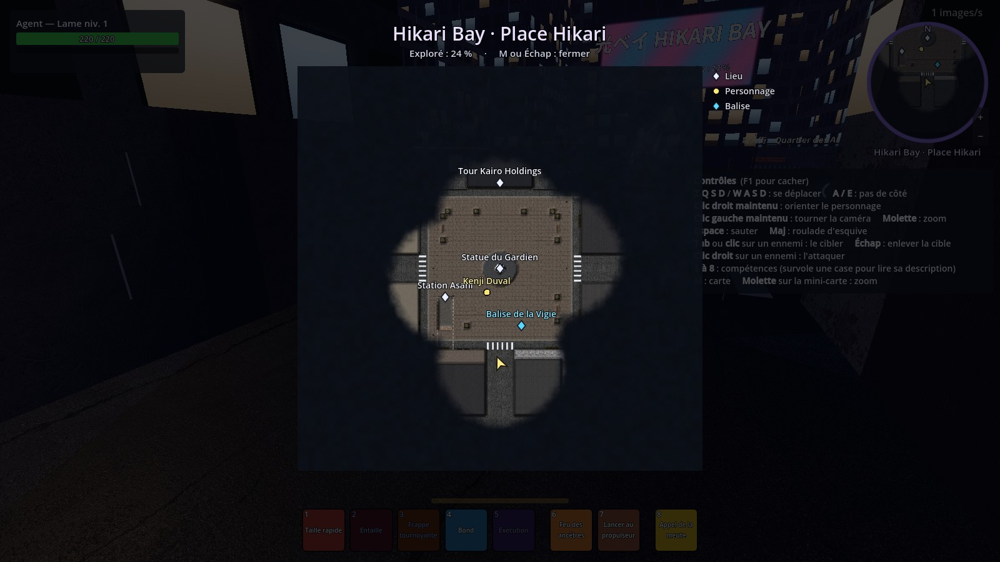

# La carte



## En jeu

- La **mini-carte** est en haut à droite. Elle suit ton personnage (la flèche dorée), le nord est en haut.
  - **Molette** au-dessus, ou boutons **+** et **−** : zoom.
  - **Clic** dessus : ouvre la grande carte.
- **M** ouvre ou ferme la **grande carte** (M reste M en AZERTY comme en QWERTY). **Échap** ou **clic droit** la ferme aussi.
- Au début, la carte est cachée sous un **brouillard**. Il se lève autour de toi au fur et à mesure que tu explores. La grande carte indique le pourcentage déjà exploré.
- Quand tu entres dans une zone, son nom s'affiche en grand au milieu de l'écran.
- Chaque **personnage** a sa propre carte. Elle est gardée sur ton PC dans `user://cartes/<nom du personnage>.cfg`. Plus tard, elle sera gardée sur le serveur avec les comptes.

## Les repères

| Icône | Sens |
|---|---|
| Losange blanc | Lieu |
| Rond jaune « ! » | Quête à prendre |
| Rond jaune « ? » | Quête à rendre |
| Point jaune | Personnage (PNJ) |
| Rond orange « ¥ » | Marchand |
| Anneau violet | Portail |
| Triangle rouge | Danger (loups…) |
| Losange bleu | Balise de la Vigie |
| Point bleu | Autre joueur |

Un repère n'apparaît qu'une fois l'endroit découvert, sauf s'il est marqué « toujours visible » (une quête qu'on vient d'accepter, par exemple). Une quête toujours visible reste collée au bord de la mini-carte quand elle est loin.

Ces repères apparaissent tout seuls, sans rien ajouter :
- les personnages du hub (groupe `pnj`), avec leur nom ;
- les portails actifs (groupe `portail_actif`) ;
- les balises de la Vigie (groupe `balises`).

## Ajouter une carte à un nouveau lieu (dans Godot)

1. Dans la scène du lieu, ajoute un nœud **Node3D** et donne-lui le script `scripts/carte/zone_carte.gd`.
2. Place-le au **centre** du lieu. Dans l'Inspecteur, règle :
   - `identifiant` : un nom court sans espace ni accent (`prehistoire_ile`). Il sert à la sauvegarde, ne le change plus ensuite ;
   - `nom_affiche` : le nom montré au joueur (« Île de la Préhistoire ») ;
   - `taille` : largeur, hauteur et profondeur en mètres. La boîte violette dans l'éditeur montre ce qui sera sur la carte ;
   - `rayon_decouverte` : distance dévoilée autour du joueur (vide = 30 m ; plus petit pour un intérieur) ;
   - `brouillard` : décoche pour un lieu déjà connu ;
   - `image` : facultatif, une carte dessinée à la main. Sinon, la carte est dessinée toute seule (vue du ciel + relief) quand le joueur arrive.
3. Pour un **intérieur** ou un **sous-sol** (comme le QG de la Vigie), ajoute une deuxième zone plus petite, à la bonne hauteur : c'est toujours la plus petite zone qui contient le joueur qui s'affiche.

## Ajouter un repère

- **Dans l'éditeur** : ajoute un **Node3D** avec le script `scripts/carte/marqueur_carte.gd`, puis choisis `type`, `libelle`, `toujours_visible` et `sur_mini_carte`.
- **Par le code** :

```gdscript
const MarqueurCarte := preload("res://scripts/carte/marqueur_carte.gd")
MarqueurCarte.creer(self, MarqueurCarte.Type.QUETE, "Le Gardien", Vector3(10, 0, 4), true)
```

Pour retirer un repère (quête rendue), supprime simplement le nœud.

## Pour les programmeurs

- `Cartographe` (autoload) : zone actuelle, brouillard, sauvegarde, dessin de la carte. Fonctions utiles : `reveler(point, rayon)`, `reveler_tout()`, `est_decouvert(point)`, `part_exploree()`, `marqueurs()`, `effacer_personnage(nom)`. Signaux `zone_changee` et `brouillard_change`.
- `scripts/interface/carte_interface.gd` : mini-carte, grande carte, annonce du nom de la zone.
- `shaders/carte.gdshader` : dessin (vue du ciel × relief, brouillard brumeux).
- Test : `godot --headless --path game -s res://tests/test_carte.gd`. Captures : `godot --path game -s res://tests/capture_carte.gd -- hub|qg|colline`.
