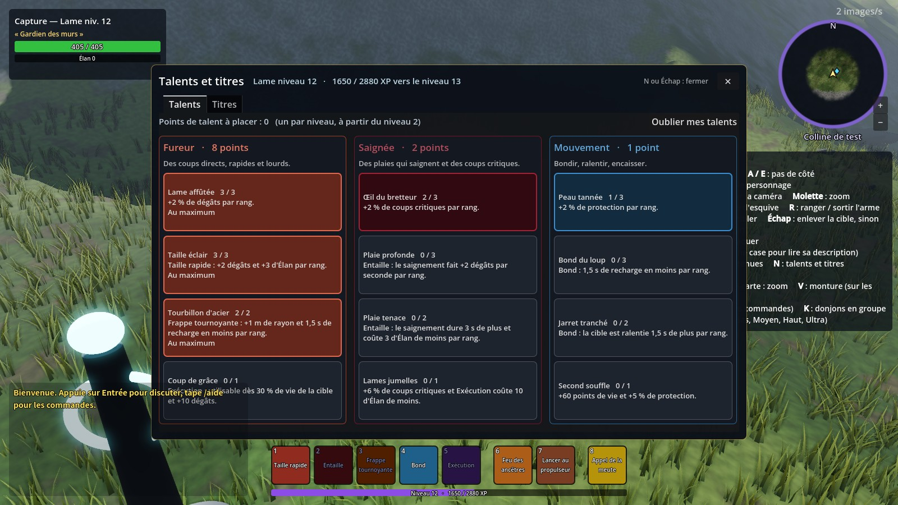
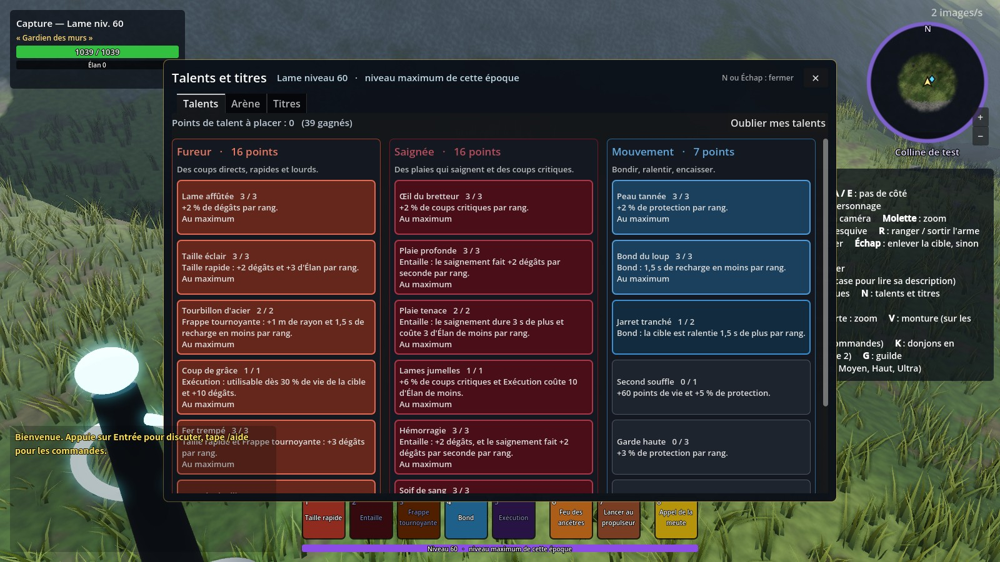
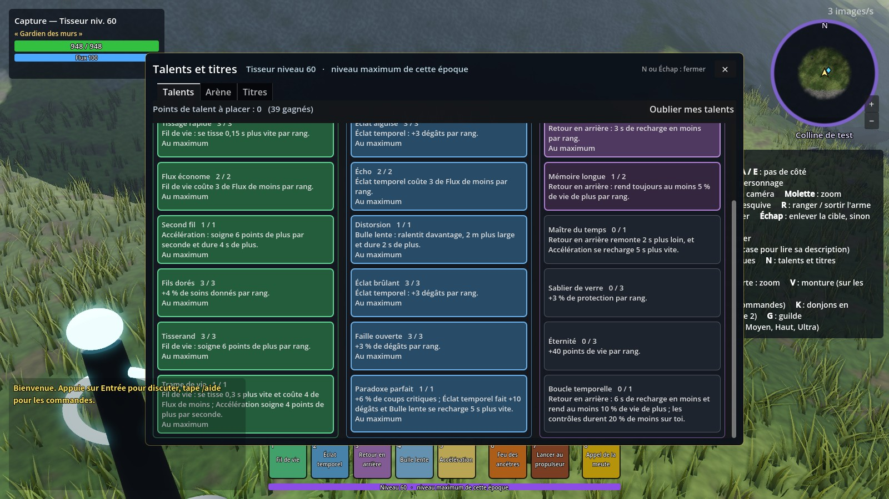
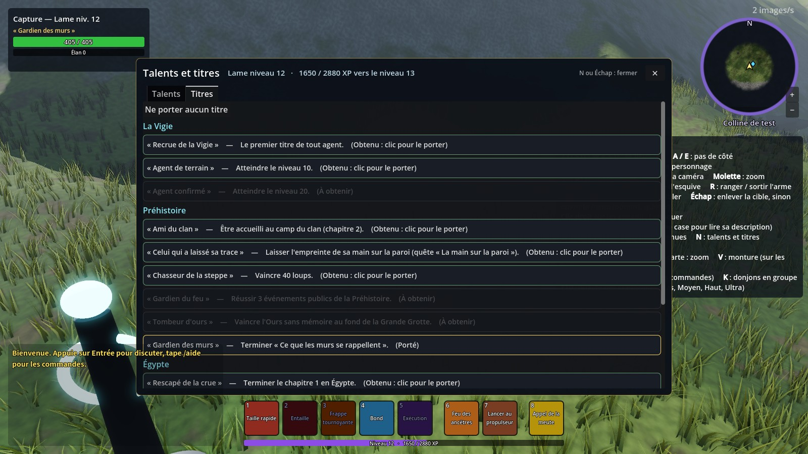

# La progression : niveaux, talents et titres

Ton personnage progresse de trois façons : il **monte de niveau**, il place des **points de talent**, et il gagne des **titres**.

- **Touche N** : ouvre la fenêtre *Talents et titres*.
- La **barre violette** sous les compétences montre ton expérience (XP) jusqu'au niveau suivant.
- Le titre porté s'affiche **sous ton nom**, dans ton cadre en haut à gauche et au-dessus de ta tête pour les autres joueurs.

## Les niveaux

- Une île = 10 niveaux : Préhistoire 1 à 10, Égypte 10 à 20, Grèce 20 à 30, Rome 30 à 40, Chine 40 à 50. Le niveau maximum est **60** (pour l'île suivante) ; il montera de 10 à chaque nouvelle époque.
- L'XP vient surtout des **quêtes** (chaque étape, avec un gros bonus en fin de chapitre), puis des **quêtes secondaires**, des **événements publics** (selon ta participation : or, argent, bronze), des **ennemis** et de la **première visite de chaque zone**. Les missions des habitants du hub rapportent aussi un peu.
- Un ennemi beaucoup plus faible que toi rapporte peu ; un ennemi plus fort rapporte jusqu'à 50 % de plus.
- Chaque niveau donne **+6 % de vie de base** et **+2,5 % de dégâts**.
- **Points de talent** : un par niveau du niveau 2 au niveau 20 (19 points), puis un tous les deux niveaux (niveaux 22, 24… 60) : **39 points au niveau 60**. La fenêtre indique le prochain niveau qui donne un point.
- Pour devenir vraiment plus fort, il faut aussi l'**équipement de chaque île** : voir [l'Arsenal des époques](l-arsenal-des-epoques.md).
- Les 5 compétences de classe restent toutes disponibles dès le niveau 1 : ce sont les talents qui les transforment.

**Si tu avais déjà joué avant les niveaux** : au premier lancement, le jeu regarde les quêtes que tu as déjà faites et te rend d'un coup l'XP et les titres correspondants.

## Les talents

Chaque classe a **3 voies** de **7 talents** (un par palier). Les talents du haut sont ouverts tout de suite ; pour les suivants, il faut avoir mis assez de points **dans la même voie** : 3 points pour le palier 2, 6 pour le palier 3, 8 pour le palier 4, 9 pour le palier 5, 12 pour le palier 6 et 15 pour le **palier 7**, le talent ultime de la voie (le plus fort). Une voie complète coûte 16 points : au niveau 20 (19 points), tu finis les 4 premiers paliers de deux voies ; au niveau 60 (39 points), tu finis deux voies entières et tu mets 7 points dans la troisième. Il faut donc choisir !

Dans l'Arène JcJ, ces talents sont mis de côté : on y utilise des **talents d'Arène** à part (onglet *Arène* de la même fenêtre, 3 à choisir parmi 6, voir [l'Arène JcJ](l-arene-jcj.md)).

Clique sur un talent pour y mettre un point. Le bouton **Oublier mes talents** rend tous les points, gratuitement, quand tu n'es pas en combat. Changer de classe remet aussi les talents à zéro.

### Lame

**Fureur** : Des coups directs, rapides et lourds.

| Palier | Talent | Rangs | Effet |
|---|---|---|---|
| 1 | Lame affûtée | 3 | +2 % de dégâts par rang. |
| 2 | Taille éclair | 3 | Taille rapide : +2 dégâts et +3 d'Élan par rang. |
| 3 | Tourbillon d'acier | 2 | Frappe tournoyante : +1 m de rayon et 1,5 s de recharge en moins par rang. |
| 4 | Coup de grâce | 1 | Exécution : utilisable dès 30 % de vie de la cible et +10 dégâts. |
| 5 | Fer trempé | 3 | Taille rapide et Frappe tournoyante : +3 dégâts par rang. |
| 6 | Rage du duelliste | 3 | +3 % de dégâts par rang. |
| 7 | Lame des siècles | 1 | Exécution : utilisable dès 35 % de vie de la cible (avec Coup de grâce), +20 dégâts et 2 s de recharge en moins. |

**Saignée** : Des plaies qui saignent et des coups critiques.

| Palier | Talent | Rangs | Effet |
|---|---|---|---|
| 1 | Œil du bretteur | 3 | +2 % de coups critiques par rang. |
| 2 | Plaie profonde | 3 | Entaille : le saignement fait +2 dégâts par seconde par rang. |
| 3 | Plaie tenace | 2 | Entaille : le saignement dure 3 s de plus et coûte 3 d'Élan de moins par rang. |
| 4 | Lames jumelles | 1 | +6 % de coups critiques et Exécution coûte 10 d'Élan de moins. |
| 5 | Hémorragie | 3 | Entaille : +2 dégâts, et le saignement fait +2 dégâts par seconde par rang. |
| 6 | Soif de sang | 3 | Tu regagnes 2 % des dégâts que tu infliges en vie, par rang. |
| 7 | Mille entailles | 1 | +8 % de coups critiques ; Entaille coûte 5 d'Élan de moins et le saignement dure 4 s de plus. |

**Mouvement** : Bondir, ralentir, encaisser.

| Palier | Talent | Rangs | Effet |
|---|---|---|---|
| 1 | Peau tannée | 3 | +2 % de protection par rang. |
| 2 | Bond du loup | 3 | Bond : 1,5 s de recharge en moins par rang. |
| 3 | Jarret tranché | 2 | Bond : la cible est ralentie 1,5 s de plus par rang. |
| 4 | Second souffle | 1 | +60 points de vie et +5 % de protection. |
| 5 | Garde haute | 3 | +3 % de protection par rang. |
| 6 | Endurance du voyageur | 3 | +50 points de vie par rang. |
| 7 | Ombre insaisissable | 1 | +100 points de vie, Bond se recharge 4 s plus vite, et étourdissements, immobilisations et ralentissements durent 30 % de moins sur toi. |

### Rempart

**Bastion** : Encaisser plus, et plus longtemps.

| Palier | Talent | Rangs | Effet |
|---|---|---|---|
| 1 | Cuir épais | 3 | +2 % de protection par rang. |
| 2 | Mur inébranlable | 3 | Mur de bouclier : dure 1 s de plus par rang. |
| 3 | Bouclier leste | 2 | Mur de bouclier : 5 s de recharge en moins par rang. |
| 4 | Forteresse | 1 | +100 points de vie, et le Mur de bouclier arrête 70 % des dégâts au lieu de 60 %. |
| 5 | Peau de bronze | 3 | +3 % de protection par rang. |
| 6 | Colosse | 3 | +80 points de vie par rang. |
| 7 | Rempart éternel | 1 | Mur de bouclier : dure 3 s de plus et se recharge 5 s plus vite ; +5 % de protection. |

**Défi** : Attirer les ennemis et les garder sur soi.

| Palier | Talent | Rangs | Effet |
|---|---|---|---|
| 1 | Voix forte | 3 | Coup de bouclier : la menace augmente de 1 par rang. |
| 2 | Regard de défi | 3 | Provocation : 1,5 s de recharge en moins par rang. |
| 3 | Onde sismique | 2 | Onde de choc : +1 m de rayon et étourdit 0,5 s de plus par rang. |
| 4 | Point de ralliement | 1 | Provocation : dure 2 s de plus et porte 5 m plus loin. |
| 5 | Coup retentissant | 3 | Coup de bouclier : +3 dégâts et +1 de menace par rang. |
| 6 | Onde écrasante | 3 | Onde de choc : +5 dégâts et 1 s de recharge en moins par rang. |
| 7 | Défi absolu | 1 | Provocation : 3 s de recharge en moins et dure 2 s de plus ; les contrôles durent 25 % de moins sur toi. |

**Gardien** : Protéger les autres et rendre les coups.

| Palier | Talent | Rangs | Effet |
|---|---|---|---|
| 1 | Vigueur | 3 | +20 points de vie par rang. |
| 2 | Élan protecteur | 3 | Charge protectrice : 3 s de recharge en moins par rang. |
| 3 | Garde prolongée | 2 | Charge protectrice : l'allié est protégé 2 s de plus par rang. |
| 4 | Riposte | 1 | +6 % de dégâts et Coup de bouclier fait +6 dégâts. |
| 5 | Main lourde | 3 | +3 % de dégâts par rang. |
| 6 | Sang-froid | 3 | Tu regagnes 2 % des dégâts que tu infliges en vie, par rang. |
| 7 | Bouclier des innocents | 1 | +150 points de vie ; Charge protectrice se recharge 6 s plus vite et protège l'allié 4 s de plus. |

### Traqueur

**Précision** : Le tir parfait, de très loin.

| Palier | Talent | Rangs | Effet |
|---|---|---|---|
| 1 | Œil de faucon | 3 | +2 % de coups critiques par rang. |
| 2 | Souffle retenu | 3 | Tir visé : se prépare 0,2 s plus vite par rang. |
| 3 | Flèche perçante | 2 | Tir visé : +6 dégâts par rang. |
| 4 | Tir mortel | 1 | Tir visé : 3 s de recharge en moins et 5 m de portée en plus. |
| 5 | Pointes d'acier | 3 | Tir rapide : +3 dégâts par rang. |
| 6 | Œil de lynx | 3 | +2 % de coups critiques et +1 % de dégâts par rang. |
| 7 | Tir de légende | 1 | Tir visé : +20 dégâts, se prépare 0,3 s plus vite et se recharge 2 s plus vite. |

**Venins** : Empoisonner et laisser le temps agir.

| Palier | Talent | Rangs | Effet |
|---|---|---|---|
| 1 | Pointes trempées | 3 | Flèche empoisonnée : le poison fait +1 dégât par seconde par rang. |
| 2 | Venin lent | 3 | Flèche empoisonnée : le poison dure 2 s de plus par rang. |
| 3 | Carquois économe | 2 | Flèche empoisonnée coûte 3 et Tir rapide 2 de Concentration de moins par rang. |
| 4 | Toxines du marais | 1 | +6 % de dégâts et le poison fait +3 dégâts par seconde. |
| 5 | Venin concentré | 3 | Flèche empoisonnée : le poison fait +2 dégâts par seconde par rang. |
| 6 | Dard barbelé | 3 | Flèche empoisonnée : +3 dégâts, et le poison dure 1 s de plus par rang. |
| 7 | Fléau des époques | 1 | +8 % de dégâts ; le poison fait +4 dégâts par seconde et Flèche empoisonnée coûte 5 de Concentration de moins. |

**Survie** : Pièges, distance et sang-froid.

| Palier | Talent | Rangs | Effet |
|---|---|---|---|
| 1 | Pas léger | 3 | +2 % de protection par rang. |
| 2 | Collet renforcé | 3 | Piège à collet : immobilise 1 s de plus par rang. |
| 3 | Repli rapide | 2 | Repli : 3 s de recharge en moins par rang. |
| 4 | Maître des pièges | 1 | Piège à collet : +10 dégâts, rayon plus large et 5 s de recharge en moins. |
| 5 | Cuir de chasse | 3 | +3 % de protection par rang. |
| 6 | Instinct de survie | 3 | +50 points de vie par rang. |
| 7 | Ombre de la steppe | 1 | Repli : 4 s de recharge en moins, les ennemis restent ralentis 2 s de plus ; les contrôles durent 25 % de moins sur toi. |

### Tisseur

**Renouveau** : Soigner plus fort et plus vite.

| Palier | Talent | Rangs | Effet |
|---|---|---|---|
| 1 | Mains apaisantes | 3 | Fil de vie : soigne 4 points de plus par rang. |
| 2 | Tissage rapide | 3 | Fil de vie : se tisse 0,15 s plus vite par rang. |
| 3 | Flux économe | 2 | Fil de vie coûte 3 de Flux de moins par rang. |
| 4 | Second fil | 1 | Accélération : soigne 6 points de plus par seconde et dure 4 s de plus. |
| 5 | Fils dorés | 3 | +4 % de soins donnés par rang. |
| 6 | Tisserand | 3 | Fil de vie : soigne 6 points de plus par rang. |
| 7 | Trame de vie | 1 | Fil de vie : se tisse 0,3 s plus vite et coûte 4 de Flux de moins ; Accélération soigne 4 points de plus par seconde. |

**Paradoxe** : Blesser avec le temps lui-même.

| Palier | Talent | Rangs | Effet |
|---|---|---|---|
| 1 | Esprit vif | 3 | +2 % de dégâts par rang. |
| 2 | Éclat aiguisé | 3 | Éclat temporel : +3 dégâts par rang. |
| 3 | Écho | 2 | Éclat temporel coûte 3 de Flux de moins par rang. |
| 4 | Distorsion | 1 | Bulle lente : ralentit davantage, 2 m plus large et dure 2 s de plus. |
| 5 | Éclat brûlant | 3 | Éclat temporel : +3 dégâts par rang. |
| 6 | Faille ouverte | 3 | +3 % de dégâts par rang. |
| 7 | Paradoxe parfait | 1 | +6 % de coups critiques ; Éclat temporel fait +10 dégâts et Bulle lente se recharge 5 s plus vite. |

**Chronomancie** : Revenir en arrière, encore et encore.

| Palier | Talent | Rangs | Effet |
|---|---|---|---|
| 1 | Constance | 3 | +15 points de vie par rang. |
| 2 | Retour précis | 3 | Retour en arrière : 3 s de recharge en moins par rang. |
| 3 | Mémoire longue | 2 | Retour en arrière : rend toujours au moins 5 % de vie de plus par rang. |
| 4 | Maître du temps | 1 | Retour en arrière remonte 2 s plus loin, et Accélération se recharge 5 s plus vite. |
| 5 | Sablier de verre | 3 | +3 % de protection par rang. |
| 6 | Éternité | 3 | +40 points de vie par rang. |
| 7 | Boucle temporelle | 1 | Retour en arrière : 6 s de recharge en moins et rend au moins 10 % de vie de plus ; les contrôles durent 20 % de moins sur toi. |

## Les titres

Un titre se gagne une fois pour toutes. Dans l'onglet **Titres** de la fenêtre (touche N), clique sur un titre obtenu pour le porter.

| Époque | Titre | Comment l'obtenir |
|---|---|---|
| La Vigie | « Recrue de la Vigie » | Le premier titre de tout agent. |
| La Vigie | « Agent de terrain » | Atteindre le niveau 10. |
| La Vigie | « Agent confirmé » | Atteindre le niveau 20. |
| La Vigie | « Agent émérite » | Atteindre le niveau 30. |
| La Vigie | « Agent d'élite » | Atteindre le niveau 40. |
| La Vigie | « Maître des époques » | Atteindre le niveau 50. |
| La Vigie | « Gardien des siècles » | Atteindre le niveau 60. |
| Préhistoire | « Ami du clan » | Être accueilli au camp du clan (chapitre 2). |
| Préhistoire | « Celui qui a laissé sa trace » | Laisser l'empreinte de sa main sur la paroi (quête « La main sur la paroi »). |
| Préhistoire | « Chasseur de la steppe » | Vaincre 40 loups. |
| Préhistoire | « Gardien du feu » | Réussir 3 événements publics de la Préhistoire. |
| Préhistoire | « Tombeur d'ours » | Vaincre l'Ours sans mémoire au fond de la Grande Grotte. |
| Préhistoire | « Gardien des murs » | Terminer « Ce que les murs se rappellent ». |
| Égypte | « Rescapé de la crue » | Terminer le chapitre 1 en Égypte. |
| Égypte | « Compagnon de Khéops » | Graver la marque de l'équipe (quête « La marque de l'équipe »). |
| Égypte | « Fléau des crocodiles » | Vaincre 25 crocodiles. |
| Égypte | « Ami des bâtisseurs » | Terminer toutes les quêtes secondaires d'Égypte. |
| Égypte | « Pourfendeur d'Isfet » | Vaincre Isfet au cœur de la pyramide. |
| Égypte | « Bâtisseur de Gizeh » | Terminer la quête principale d'Égypte. |
| Grèce | « Témoin d'Hérodote » | Recueillir les souvenirs des derniers de Marathon (quête « Les derniers de Marathon »). |
| Grèce | « Athlète des Panathénées » | Battre le champion de la palestre (quête « La palestre »). |
| Grèce | « Ami d'Athènes » | Terminer toutes les quêtes secondaires de Grèce. |
| Grèce | « Vainqueur des Jeux » | Réussir 3 événements publics de Grèce. |
| Rome | « Témoin du Vésuve » | Recueillir les témoignages des rescapés pour Pline (quête « Ce qu'a vu Pline »). |
| Rome | « Gladiateur du Ludus » | Désarmer le champion du Ludus Magnus (quête « L'école des gladiateurs »). |
| Rome | « Ami du peuple romain » | Terminer toutes les quêtes secondaires de Rome. |
| Rome | « Gardien de la Ville » | Réussir 3 événements publics de Rome. |
| Arène de la baie | « Baptême de l'arène » | Gagner un premier combat à l'Arène de la baie. |
| Arène de la baie | « Habitué de l'arène » | Gagner 25 combats à l'Arène. |
| Arène de la baie | « Vétéran de l'arène » | Gagner 100 combats à l'Arène. |
| Arène de la baie | « Espoir de la baie » | Atteindre une cote de 1 600 à l'Arène. |
| Arène de la baie | « Combattant de la baie » | Atteindre une cote de 1 750 à l'Arène. |
| Arène de la baie | « Étoile de l'arène » | Atteindre une cote de 1 900 à l'Arène. |
| Arène de la baie | « Légende de la baie » | Atteindre une cote de 2 100 à l'Arène. |
| Arène de la baie | « Grand nom de l'arène » | Entrer dans les 10 premiers du classement de l'Arène (après 10 combats). |
| Arène de la baie | « Champion de la baie » | Prendre la 1re place du classement de l'Arène (après 10 combats). |

## Tout régler sans code

Tout est dans `game/data/progression.json` (à ouvrir avec un éditeur de texte) :

- `niveaux` : l'XP demandée par niveau, le niveau maximum, la vie et les dégâts gagnés par niveau.
- `xp` : combien rapporte chaque source (étape de quête, fin de chapitre, ennemi, événement…).
- `zones` : le niveau de chaque zone (sert à calculer l'XP des quêtes).
- `talents` : les voies et talents de chaque classe (nom, texte, effet par rang).
- `titres` : la liste des titres et leur condition.

Le test `tests/test_progression.gd` vérifie les règles (niveau 60, points de talent, 7 paliers), l'équilibre (on finit la Préhistoire vers le niveau 10 et l'Égypte vers le niveau 20) et que chaque talent modifie bien une vraie compétence. Les tableaux de ce guide se refont avec `python3 tools/progression/ecrire_guides.py`.
