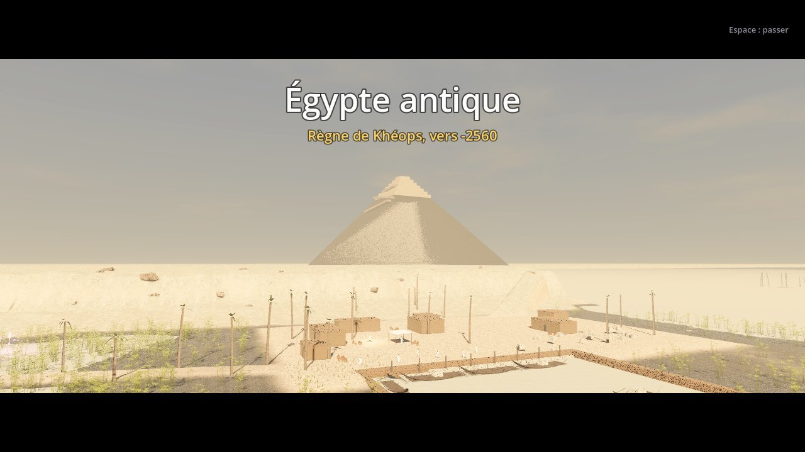

# Les cinématiques

Depuis le 15/11/2026, les îles ont de **courtes cinématiques** jouées avec le moteur du jeu :
la caméra quitte ton personnage, des bandes noires apparaissent en haut et en bas,
et des sous-titres racontent la scène.

## Les cinématiques

| Où | Quand | Ce qu'on voit |
|---|---|---|
| Préhistoire, Côte Gelée | première arrivée | la côte, le portail, Lenoir blessé, la faille du nord |
| Préhistoire, Forêt des Bouleaux | chapitre 5, la faille refermée | la montre à gousset « E. » qui brille dans la neige |
| Égypte, Port des Marais | première arrivée | le Nil en crue, la pyramide au loin, le port, l'agent Farouk |
| Égypte, Désert Rouge | chapitre 5, dans la cour de la tombe | la rencontre avec **Vera Lind**, « Sablier » |
| Égypte, Village des Bâtisseurs | chapitre 7, après le halage | les gardes des Effaceurs attaquent la pierre de faîte |
| Égypte, Cœur de la Pyramide | chapitre 8 | Djedi, le chef des gardes, puis **Isfet** dans la chambre du Roi |

## Pendant une cinématique

- **Espace** (ou **Échap**) : passer la cinématique.
- Ton personnage ne bouge pas et les ennemis attendent la fin.
- Chaque cinématique se joue **une seule fois** par personnage.
- Pour en revoir une : **Échap > Revoir une cinématique** (la liste montre celles de la zone où tu es).
- En multijoueur, les cinématiques ne se jouent pas (chacun avance à son rythme).

## Changer les textes ou la caméra

Tout est dans `game/data/cinematiques.json`. Chaque cinématique est une suite de **plans** :

- `duree` : durée du plan en secondes ;
- `camera` : d'où part la caméra et où elle arrive, `[x, hauteur au-dessus du sol, z]` ;
- `regard` : ce que la caméra regarde (un point, ou `"joueur"`, `"pnj:farouk"`, `"ennemi:isfet"`…) ;
- `titre` / `sous_titre` : grand texte au milieu de l'écran ;
- `nom` + `texte` : une réplique ; `texte` seul : une narration ;
- `fov` : l'angle de vue (plus petit = plus zoomé).

Tu peux changer les phrases librement : garde les guillemets `"` autour des textes et les virgules entre les lignes.
Pour revoir ta modification, utilise **Échap > Revoir une cinématique** dans la bonne zone.
