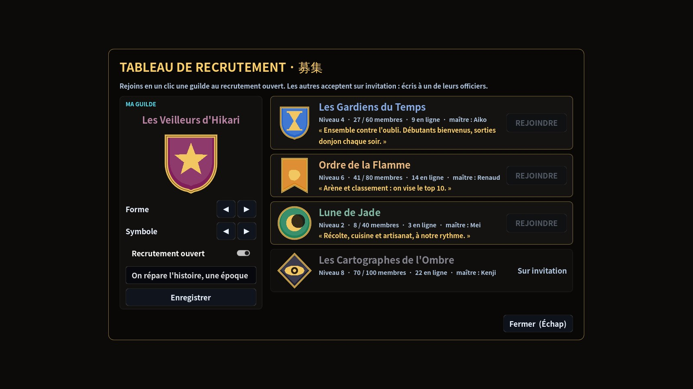

# Les guildes

Une **guilde**, c'est un groupe d'agents qui voyagent sous la même bannière : une liste de membres avec des rangs, une **banque** partagée, des **contrats** chaque semaine qui font monter la guilde de niveau, et un canal de discussion rien qu'à elle.

Tout se passe dans la **Maison des guildes** (quartier des Résidences, à l'ouest de Hikari Bay) et dans la fenêtre **Guilde** : touche **G** (ou `/guilde`).

## Fonder une guilde

1. Fais la mission **« Trois signatures »** d'Aleksander Nowak, le registraire de la Maison des guildes.
2. Reparle-lui : il te propose de **fonder ta guilde**. Choisis son nom (3 à 24 lettres) et la couleur de sa bannière.
3. Le serveur l'enregistre. Ta bannière est accrochée dans la Maison des guildes et dans ton appartement 1204. Tu en es le **maître de guilde**.

Deux guildes ne peuvent pas porter le même nom (ni celui des guildes du décor : les Veilleurs, l'Ordre du Loup…).

Si tu avais déjà fondé une guilde avant cette mise à jour, elle est reprise automatiquement, avec son nom et sa couleur, et tu en es le maître.

## Les membres et les rangs

| Rang | Inviter | Exclure, promouvoir | Message de guilde | Sortir des objets de la banque |
|---|---|---|---|---|
| **Maître de guilde** | oui | oui | oui | sans limite |
| **Officier** | oui | oui (rangs en dessous) | oui | 20 par jour |
| **Membre** | non | non | non | 5 par jour |
| **Recrue** | non | non | non | aucun (dépôts seulement) |

- **Inviter** : `/ginviter Nom`, ou clique sur le joueur pour le cibler puis sur **Inviter dans la guilde** (sous son cadre). Il voit *Rejoindre la guilde / Refuser*. Un nouveau membre commence **Recrue**.
- **Onglet Membres** : qui est en ligne (en vert), le rang, ce que chacun a fait cette semaine, et les boutons **▲ Promouvoir**, **▼ Rétrograder**, **Exclure**, **♛ Nommer maître** selon ton rang.
- **Quitter** : bouton en bas de l'onglet Membres, ou `/gquitter`. Si le maître part, l'officier le plus ancien le remplace. Le dernier membre qui part **dissout** la guilde (il faut d'abord vider la banque).
- **Message de guilde** (onglet Guilde, ou `/gmessage texte`) : affiché à chaque membre quand il se connecte.
- **Discussion** : `/gu message` (canal Guilde, en vert).

Au départ, une guilde accueille **30 membres**, puis **10 de plus par niveau**.

## La banque

Le **coffre de la guilde** est contre le mur ouest de la Maison des guildes. Approche-toi et appuie sur **F** (ou ouvre l'onglet **Banque** de la fenêtre G).

- **Déposer** : clique sur un objet de tes sacs (en bas). Toute la pile part dans la banque.
- **Prendre** : clique sur un objet de la banque (en haut). Une pile compte pour un objet dans la limite du jour.
- On voit la banque de partout, mais on ne dépose et on ne prend **qu'à côté du coffre**.
- Tout est écrit dans l'onglet **Journal** (qui a déposé ou pris quoi, qui est entré, qui a été promu…).
- La banque a **24 places** au niveau 1, puis **8 de plus par niveau**.

## Les contrats de la semaine

Chaque lundi (à 6 h, comme les missions de la semaine), la guilde reçoit **trois contrats** tirés parmi neuf : vaincre des créatures de fracture, vaincre des ennemis, récolter, rendre des missions du jour, participer à des événements publics, abattre des chefs (l'Ours Sans Mémoire, Isfet…), avancer les quêtes des îles, combattre à l'Arène, fabriquer ou cuisiner.

- **Tout le monde y travaille en même temps**, sur toutes les îles : chaque ennemi vaincu, chaque récolte, chaque étape de quête compte.
- Le nombre à atteindre dépend du nombre de membres de la guilde (une guilde de 1 n'a pas les mêmes contrats qu'une guilde de 20).
- Le **tableau des contrats** est sur le mur sud de la Maison des guildes (**F** pour le lire), ou onglet **Contrats** (touche G).
- **Un contrat accompli** donne **12 Sceaux de guilde** (+1 par niveau de guilde) à **chaque membre qui a aidé**, et 400 XP à la guilde.
- **Les trois accomplis** : **20 Sceaux** de bonus pour chacun.
- Les sceaux arrivent directement dans les sacs. Si tu n'es pas connecté, ils t'attendent jusqu'à ta prochaine visite.

**En donjon** ou sur une île en jeu solo pendant que ta guilde vit sur un serveur en ligne, ce que tu fais est **gardé sur ton PC** et compté pour ta guilde dès ton retour en ville.

## Le niveau de la guilde

Chaque action des membres rapporte un peu d'**XP de guilde** (un chef ou un donjon beaucoup plus qu'un loup), et chaque contrat accompli 400. La guilde monte jusqu'au **niveau 10**. Chaque niveau donne **+8 places de banque**, **+10 membres** et **+1 sceau par contrat**.

## L'intendante : échanger ses sceaux

**Mei Takahara**, l'intendante des guildes, attend à côté du tableau des contrats. Parle-lui pour échanger tes sceaux :

| Objet | Sceaux | Niveau de guilde |
|---|---|---|
| Insigne de guilde (bijou) | 15 | 1 |
| Veste brodée de guilde (torse) | 25 | 1 |
| Banquet de guilde × 2 (repas) | 4 | 2 |
| Pantalon de voyage de guilde | 30 | 2 |
| Sacoche de guilde (12 places) | 35 | 3 |
| Bottes de marche de guilde | 40 | 4 |
| Lame d'apparat de la guilde (arme) | 60 | 5 |
| Étendard de guilde (relique) | 90 | 7 |

## Où vivent les guildes ?

C'est le **serveur** qui décide de tout et qui garde les guildes (fichier `sauvegardes/guildes.json` de son profil). En jeu **seul**, ton PC est son propre serveur : ta guilde vit sur ton PC. Sur un serveur en ligne (hébergé par un ami, ou le serveur officiel), la guilde vit sur ce serveur. Si ta guilde est sur un autre serveur que celui où tu joues, la fenêtre G te le dit et ce que tu fais est gardé pour elle.

## Changer les réglages

Tout est dans `game/data/guildes.json` : rangs et limites de la banque, tailles, XP par action, niveaux, liste des contrats et nombre à atteindre, sceaux donnés. Les objets de l'intendante sont dans `data/objets.json` et ses échanges dans `data/artisanat.json` (artisan « guilde », clé `niveau_guilde` pour le niveau demandé).

## Pas encore fait

- Les guildes ne sont pas partagées entre plusieurs serveurs (il faudra passer par Nakama quand il y aura plusieurs serveurs officiels).
- Pas encore d'onglets de banque séparés par rang, ni de « siège de guilde » à décorer.
- Ce qui est fait en solo ou en donjon est envoyé par le PC du joueur (comme le reste pour l'instant, le serveur ne peut pas tout vérifier).

## Tableau de recrutement, blason et devise (18/11/2026)

- Le **liège « Recrutement »** de la Maison des guildes (F), ou le bouton **Tableau de recrutement** de la fenêtre Guilde,
  montre toutes les guildes du serveur : blason, niveau, membres, maître, devise.
- Une guilde au **recrutement ouvert** se rejoint en **un clic** (bouton « Rejoindre », on arrive comme recrue).
  Les autres se rejoignent toujours sur invitation.
- Les **officiers et le maître** règlent sur ce tableau le **blason** (4 formes × 12 symboles, dans la couleur de la guilde),
  la **devise** et l'ouverture du recrutement.
- Le blason s'affiche aussi en haut de la fenêtre Guilde (touche G).

