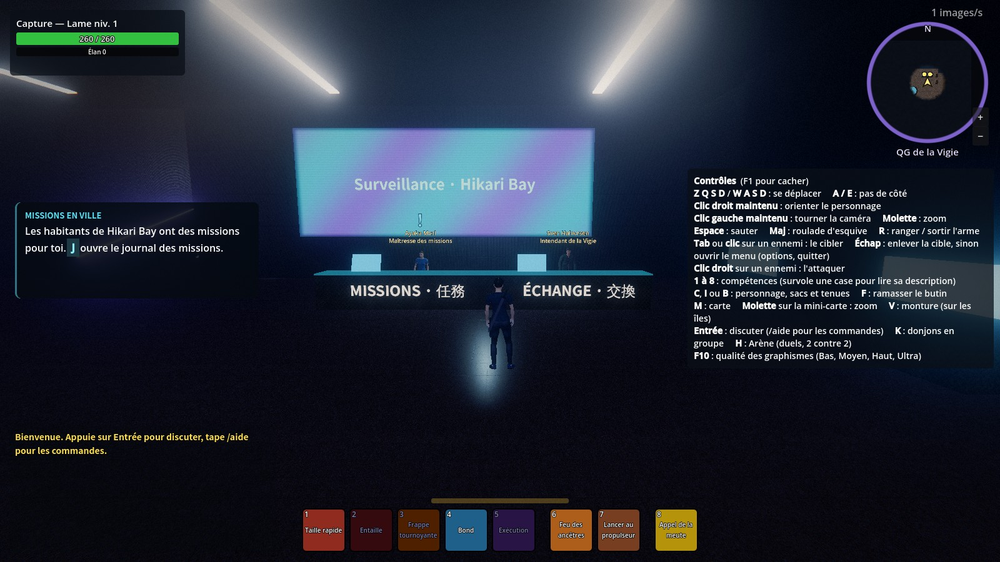
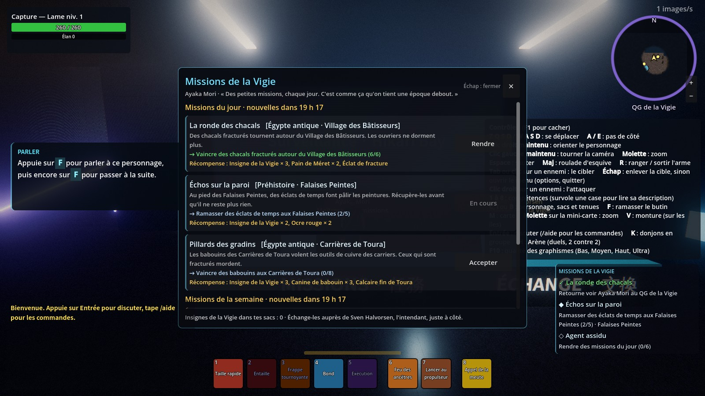
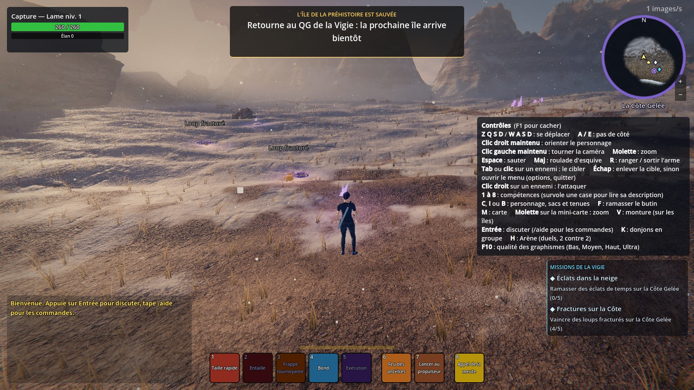
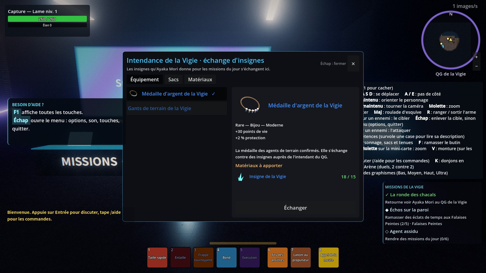

# Les missions du jour et de la semaine

Au QG de la Vigie, **Ayaka Mori**, la maîtresse des missions, propose chaque jour de petites missions sur les îles que tu as déjà visitées (Préhistoire, Égypte). Le lundi, elle a aussi des missions plus longues pour toute la semaine. Elles rapportent des **insignes de la Vigie**, que **Sven Halvorsen**, l'intendant installé juste à côté d'elle, échange contre du matériel.

C'est la raison de revenir chaque jour, comme les « quêtes journalières » de World of Warcraft.

## Où les trouver

Descends au **QG de la Vigie** (sous la station Asahi). Dans le **Hall des opérations**, juste à droite en arrivant en bas du grand escalier, il y a un comptoir devant un écran « MISSIONS · 任務 » :

- **Ayaka Mori** (à gauche) : les missions. Un **« ! » bleu** au-dessus d'elle veut dire qu'elle a des missions à te proposer, un **« ? » bleu** que tu as une mission finie à lui rendre ;
- **Sven Halvorsen** (à droite) : l'échange des insignes.

## Comment ça marche

1. Parle à Ayaka (**F**). Après ses répliques, la fenêtre des missions s'ouvre.
2. Clique sur **Accepter** pour les missions que tu veux faire (tu peux toutes les prendre).
3. Va sur l'île. Les missions suivies s'affichent **à droite de l'écran**, avec l'avancement (par exemple « Vaincre des loups fracturés sur la Côte Gelée (3/5) »).
4. Quand une mission est finie, une annonce le dit et elle passe en vert. Reviens voir Ayaka et clique sur **Rendre** : la récompense va dans tes sacs.

Il y a quatre sortes de missions :

- **vaincre** des ennemis dans une zone (loups, rennes, crocodiles, babouins, chacals, gardes de l'Effaceuse…) ;
- **ramasser des éclats de temps** : des cristaux violets qui apparaissent dans la zone quand tu acceptes la mission (appuie sur **F** à côté, puis reste immobile une seconde) ;
- **réussir un événement public** (il faut y avoir participé, au moins le palier bronze) ;
- **rendre des missions du jour** (pour la mission de la semaine « Agent assidu »).

## Quand elles changent

- **Chaque jour à 6 h** (l'heure de ton PC) : 3 nouvelles missions du jour.
- **Chaque lundi à 6 h** : 2 nouvelles missions de la semaine.
- La fenêtre d'Ayaka affiche le temps qu'il reste avant les prochaines.
- Tout le monde a **les mêmes missions le même jour** (comme dans un vrai MMO), sauf celles des îles que tu n'as pas encore visitées ou des endroits que l'histoire ne t'a pas encore ouverts.
- Une mission **pas finie** disparaît quand elle est renouvelée. Une mission **finie mais pas rendue** reste : elle apparaît dans la fenêtre sous « Missions passées à rendre ».

## L'échange des insignes

Parle à Sven : sa fenêtre ressemble à celle des artisans, avec un bouton **Échanger**. On y trouve :

- **Équipement** : la Médaille d'argent de la Vigie (15 insignes), les Gants de terrain de la Vigie (20) ;
- **Sacs** : le Sac d'expédition de la Vigie (25) ;
- **Matériaux** : éclats de fracture, peaux, tendons, bois de renne, ocre, calcaire, écailles, défense d'hippopotame (de 2 à 5 insignes).

La mission de la semaine « Agent assidu » donne aussi la **Broche de l'agent assidu** (bijou épique).

## Changer les missions toi-même

Tout est dans `game/data/quetes_du_jour.json` (ouvre-le avec le Bloc-notes ou VS Code) :

- `reglages` : l'heure du renouvellement, le nombre de missions du jour et de la semaine ;
- `quotidiennes` et `hebdomadaires` : les missions. Pour en ajouter une, copie un bloc `{ … }`, change son `id` (un mot sans espace ni accent), son titre, son texte, son objectif et sa récompense ;
- `positions` (missions d'éclats) : les endroits `[x, z]` où les éclats apparaissent.

Les prix de l'échange sont dans `game/data/artisanat.json` (les recettes qui commencent par `echange_`). Garde bien les virgules et les guillemets.

## Le tester

- Test automatique : `godot --headless --path game -s res://tests/test_quetes_du_jour.gd` (environ 3 minutes).
- Les captures de ce guide : `godot --path game -s res://tests/capture_missions_du_jour.gd -- <dossier>`.

## Limites pour l'instant

- Les missions sont gardées sur ton PC (dans `progression.cfg`, section `quetes_du_jour`), comme les quêtes secondaires des îles. En jeu à plusieurs, chaque joueur a ses propres missions, mais la récompense n'arrive que chez celui qui héberge la partie : il faudra la faire passer par le serveur quand le jeu en ligne sera branché.
- Un ennemi compte pour toi s'il est vaincu à moins de 60 m de ton personnage (pratique en groupe).
