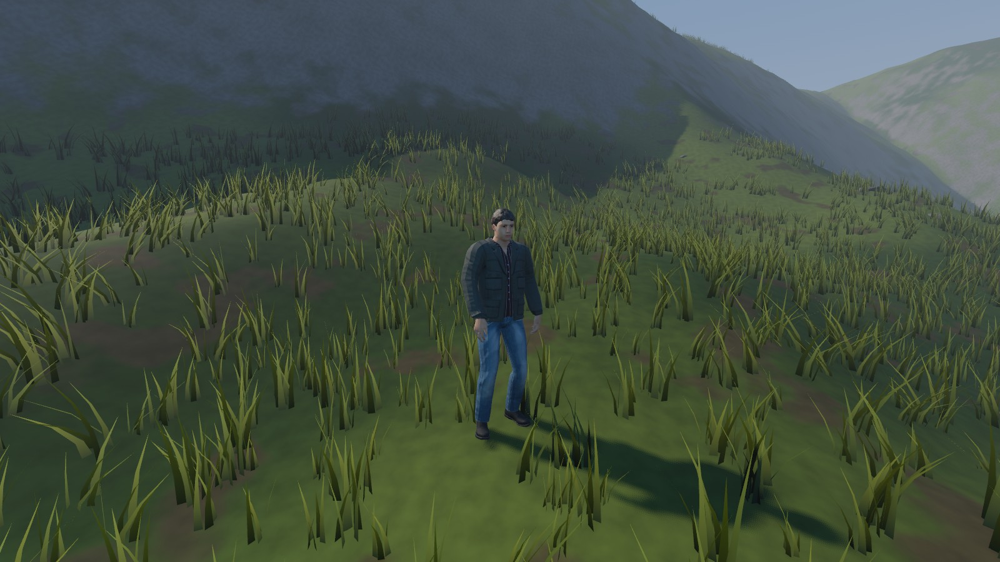

# Créer ton personnage avec MakeHuman et l'animer avec Mixamo

> **État actuel (novembre 2026) : c'est fait.** Deux agents de la Vigie (homme et femme) ont été
> créés et sont dans le jeu. Voir la section « Ce qui a été fait » en bas de page. La suite du
> guide reste utile pour créer d'autres personnages à la main.



Pour l'instant, le personnage du prototype est une silhouette provisoire faite de formes simples. Ce guide permet de fabriquer le **vrai personnage réaliste** et ses **animations**. Compte environ 1 heure la première fois.

Tout est gratuit. Il faut seulement un **compte Adobe** gratuit pour Mixamo.

Quand tu as fini, tu déposes les fichiers dans un dossier et tu me préviens : je m'occupe de les brancher dans le jeu.

---

## Partie 1 : créer le personnage dans MakeHuman

1. Lance **MakeHuman**.
2. Onglet **Modelling > Main** : règle le sexe, l'âge, la carrure, la taille… comme tu veux. Pour un agent de la Vigie, un adulte de corpulence moyenne est idéal pour commencer.
3. Onglet **Modelling > Face**, **Torso**… : affine si tu le souhaites (facultatif).
4. Onglet **Geometries** :
   - **Clothes** : choisis des vêtements simples (un pantalon, un haut, des chaussures). Évite les vêtements très amples.
   - **Eyes**, **Hair**, **Eyebrows** : choisis ce qui te plaît. Pour les cheveux, préfère une coupe courte (les cheveux longs bougent mal sans réglages avancés).
   - **Topologies** : choisis **proxy741** si elle existe (version allégée du corps, meilleure pour un jeu). Sinon laisse *None*.
5. Onglet **Pose/Animate > Skeleton** : choisis **None** (Mixamo ajoutera son propre squelette).
6. Onglet **Pose/Animate > Pose** : choisis **Tpose** (bras écartés à l'horizontale). Mixamo comprend mieux le corps dans cette position.
7. **Sauvegarde ton personnage** : onglet **Files > Save**, donne un nom (par exemple `agent_vigie`), clique sur **...** pour choisir un dossier, puis enregistre. Ça te permettra de le modifier plus tard.

### Exporter le personnage

1. Onglet **Files > Export**.
2. Dans la liste à gauche, choisis **Filmbox (fbx)**.
3. À droite, dans les options :
   - **Scale units** : **meter** ;
   - coche **Feet on ground** si l'option existe ;
   - **Binary FBX** coché.
4. En haut, clique sur **...** à côté du nom de fichier, crée un dossier `SickWorld_personnage` sur ton Bureau, et enregistre sous `agent_vigie.fbx`.
5. Dans ce dossier, MakeHuman a créé `agent_vigie.fbx` **et** un dossier `textures`.
6. Fais un clic droit sur ces deux éléments ensemble (sélectionne-les avec Ctrl), puis **Compresser vers > Fichier ZIP** (ou *Envoyer vers > Dossier compressé*). Appelle le fichier `agent_vigie.zip`. Le ZIP permet d'envoyer le corps et ses textures en une seule fois à Mixamo.

---

## Partie 2 : ajouter le squelette avec Mixamo

1. Va sur **https://www.mixamo.com** dans Chrome et connecte-toi avec un compte Adobe (création gratuite si besoin).
2. Clique sur **Upload Character** et glisse `agent_vigie.zip`.
3. Mixamo affiche ton personnage de face. Clique sur **Next**.
4. Place les ronds de couleur comme indiqué à l'écran : **menton**, **poignets**, **coudes**, **genoux**, **aine**. Laisse *Skeleton LOD* sur **Standard Skeleton (65)**. Clique sur **Next**.
5. Attends 1 à 2 minutes. Ton personnage apparaît en train de bouger. S'il est correct (pas de bras déformés), clique sur **Next**.
   - S'il est déformé : clique sur **Back** et replace les ronds plus précisément.

---

## Partie 3 : choisir et télécharger les animations

Ton personnage est maintenant sélectionné dans Mixamo. Pour chaque animation de la liste ci-dessous :

1. Tape son nom dans la barre de recherche à gauche (en anglais).
2. Clique sur l'animation qui correspond le mieux (l'aperçu se joue sur ton personnage).
3. Si une case **In Place** existe à droite, **coche-la** (le personnage court sur place : c'est le jeu qui le déplace).
4. Clique sur **Download** et règle :
   - **Format** : FBX Binary (.fbx)
   - **Skin** : *With Skin* **uniquement pour la première animation (Idle)**, puis *Without Skin* pour toutes les autres
   - **Frames per Second** : 30
   - **Keyframe Reduction** : none
5. Clique sur **Download**, puis **renomme le fichier** avec le nom indiqué dans la dernière colonne et range-le dans le dossier `SickWorld_personnage`.

| Ce qu'on cherche | Mot à taper dans Mixamo | Nom du fichier |
|---|---|---|
| Debout, immobile (respire) | `Breathing Idle` | `idle.fbx` (*With Skin*) |
| Course vers l'avant | `Running` | `courir.fbx` |
| Marche arrière | `Walking Backward` | `reculer.fbx` |
| Pas de côté à gauche | `Left Strafe` | `pas_gauche.fbx` |
| Pas de côté à droite | `Right Strafe` | `pas_droite.fbx` |
| Saut (début) | `Jump` | `saut.fbx` |
| En train de tomber | `Falling Idle` | `chute.fbx` |
| Roulade d'esquive | `Sprinting Forward Roll` | `roulade.fbx` |
| Attaque à mains nues (pour l'étape 2) | `Punching` | `attaque.fbx` |
| Touché (pour l'étape 2) | `Hit Reaction` | `touche.fbx` |
| Mort (pour l'étape 2) | `Dying` | `mort.fbx` |

Pas besoin de trouver exactement le même nom : si une variante te plaît davantage, prends-la.

---

## Partie 4 : me les envoyer

1. Vérifie que le dossier `SickWorld_personnage` sur ton Bureau contient bien : `agent_vigie.zip` et les fichiers `.fbx` de la liste.
2. Préviens-moi dans le projet (« les fichiers du personnage sont prêts »). Je demanderai l'accès à ce dossier sur ton PC, j'importerai le personnage et les animations dans le jeu, et je remplacerai la silhouette provisoire.

**Licences :** MakeHuman (CC0 pour les modèles exportés) et Mixamo (utilisation libre dans un jeu, y compris commercial) permettent de les utiliser dans SickWorld. Je noterai les crédits dans `docs/CREDITS.md`.

---

## Ce qui a été fait

### 1. Les personnages (MakeHuman, automatique)

`tools/personnages/creer_personnage.py` fabrique les deux personnages sans clic :

```
"C:\Program Files\Blender Foundation\Blender 5.2\blender.exe" --background --python tools\personnages\creer_personnage.py
```

- Les réglages (âge, taille, carrure, peau, yeux, cheveux, vêtements) sont en haut du fichier,
  dans `PERSONNAGES`.
- Le script lance MakeHuman avec un petit plugin (`tools/personnages/makehuman_auto/`), qui ne
  fait rien quand on utilise MakeHuman normalement.
- Blender corrige ensuite les normales (sinon l'aspect est facetté), enregistre un `.blend`, un
  FBX propre, un ZIP pour Mixamo et deux aperçus (`docs/images/personnages/`).
- Résultat dans `Bureau\SickWorld_personnage\` : agent_vigie_homme (1,78 m) et
  agent_vigie_femme (1,68 m), 30 ans, corps allégé (environ 1 600 sommets), sans squelette.

### 2. Mixamo

- Téléversement d'un ZIP allégé (FBX + textures 1024 px), repères placés, squelette standard (65 os).
- 11 animations par personnage, en FBX binaire, 30 images/s, sans réduction, « In Place » quand
  c'est possible : immobile (avec le personnage), courir, reculer, pas_gauche, pas_droite, saut,
  chute, roulade, attaque, touche, mort.
- Mixamo n'a pas repris les textures : le jeu les réapplique lui-même.

### 3. Dans Godot

- Fichiers : `game/assets/personnages/homme/` et `femme/` (stockés avec **Git LFS** : installer
  Git LFS avant de cloner, sinon les fichiers .fbx/.jpg/.png sont vides).
- `scenes/joueur/apparence_agent.tscn` + `scripts/joueur/apparence_agent.gd` remplacent la
  silhouette provisoire dans `joueur.tscn` (l'ancienne reste dans `apparence_provisoire.gd`).
- Dans l'inspecteur du nœud **Apparence** du joueur : `modele` (homme/femme) et `echelle`.
- L'agent choisit l'animation selon la vitesse (avant, arrière, côtés), saute, tombe, roule
  pendant l'esquive, frappe, réagit aux coups et tombe à la mort, avec des fondus doux.
- Peau : roughness 0,6 et un peu de diffusion sous la surface (moins cireuse).
- Tests : `godot --headless --path game -s res://tests/test_apparence.gd`.
- Capture : `godot --path game -s res://tests/capture_personnage.gd -- homme`.

### Limites connues

- L'attaque joue sur tout le corps : en courant, les jambes s'arrêtent le temps du coup.
- Reculer utilise une marche arrière accélérée (les pieds glissent un peu).
- Le t-shirt de la femme porte le logo MakeHuman (seule tenue féminine décontractée fournie).
- Textures réduites à 1024 px pour le dépôt ; les originales sont dans `Bureau\SickWorld_personnage\`.