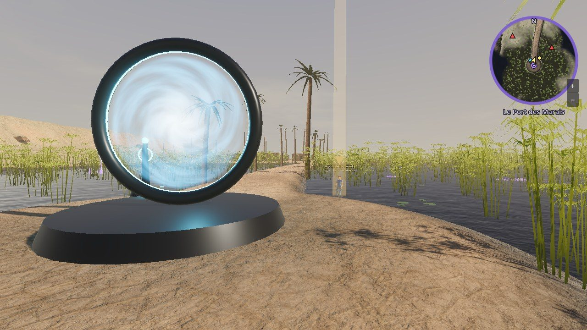
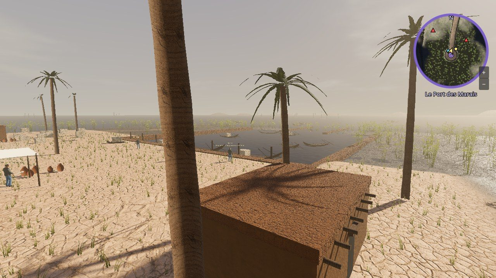
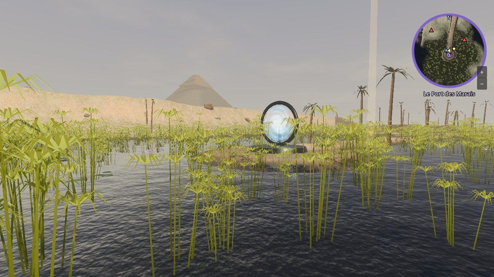
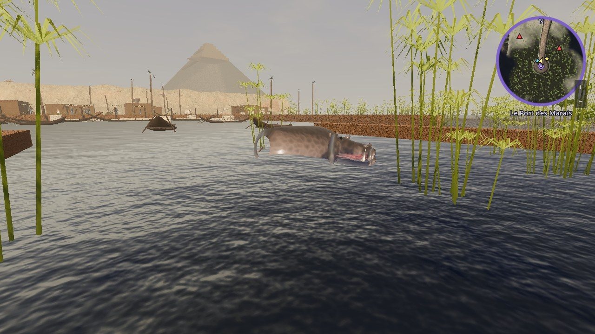
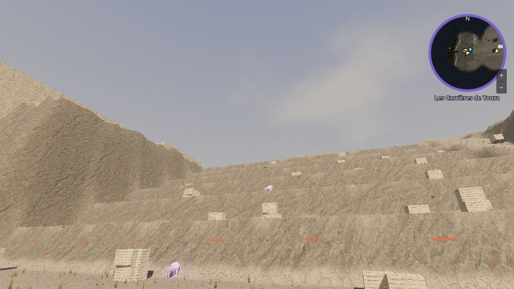
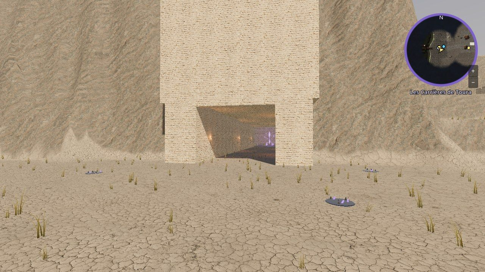
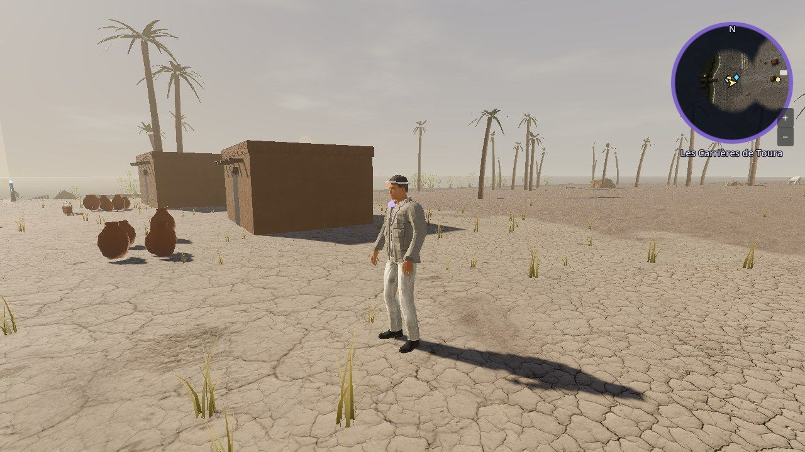
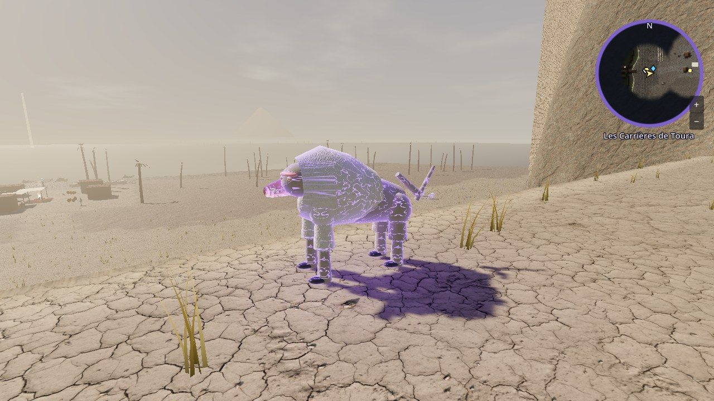

# Visiter l'Égypte : le Port des Marais et les Carrières de Toura

La première zone de l'île d'Égypte est jouable : **le Port des Marais** (niveaux 10 à 12), vers 2560 av. J.-C., pendant la 27e année du règne de Khéops. C'est là que mène le portail **Égypte antique** du QG de la Vigie.

On y trouve, du sud au nord :

- **le marais aux papyrus**, où l'on arrive par le portail, de l'eau jusqu'aux genoux, avec des lotus, la barque renversée de l'agent Farouk et ses caisses qui flottent ;
- **la levée de terre**, une digue qui traverse les champs inondés par la crue du Nil, bordée de palmiers ;
- **le port de Gizeh** : un bassin creusé, des quais en calcaire, des barques, des entrepôts en briques crues, des jarres, l'auvent d'Ânkhkhaf et un bloc de calcaire sur son traîneau ;
- **le chenal** qui relie le bassin au Nil, à l'est ;
- **la rampe** qui monte vers le plateau, au nord-ouest (le Village des Bâtisseurs ouvrira plus tard).

Au loin, à l'ouest, **la Grande Pyramide** presque terminée (le haut est encore en gradins, sans son revêtement blanc). À l'est, de l'autre côté du Nil, les falaises de **Toura**, où l'on ira au chapitre 3.

Les crocodiles et les hippopotames sont fabriqués par le code, comme les palmiers, les papyrus, les bâtiments et la pyramide. Les textures (sable, limon, terre craquelée, briques crues, calcaire, bois), les poteries, les paniers et les rochers viennent de **Poly Haven** (gratuits, licence CC0).

## L'ouvrir

1. Dans GitHub Desktop, sur la branche **main** : **Fetch origin** puis **Pull origin** (Claude le fait pour toi quand il le peut).
2. **Ferme Godot et rouvre-le** s'il était ouvert pendant la mise à jour.
3. **Par le jeu** : F5, **Jouer seul**, puis au QG de la Vigie, traverse le portail **Égypte antique** (le deuxième en partant de la gauche).
4. **Directement** : double-clique sur `scenes/monde/egypte/port_des_marais.tscn` (ou `carrieres_toura.tscn`) puis **F6**.

Pour revenir à Hikari Bay : éloigne-toi un peu du portail, puis retraverse-le.

## Le chapitre 1 : « La crue »

1. Parler à l'**agent Nadia Farouk**, trempée, près du portail (touche **F**).
2. **Repêcher 3 caisses** de la Vigie qui flottent dans les roseaux (F, rester immobile un instant).
3. Éliminer **4 crocodiles fracturés** (veines violettes) autour du portail.
4. **Installer la balise** de la Vigie sur le monticule (F, rester immobile 4 secondes) : un trépied lumineux apparaît.
5. Retourner voir Farouk, puis **refermer la faille** du marais, à l'ouest. Deux crocodiles en sortent.
6. Faire son rapport à Farouk.

## Le chapitre 2 : « L'Occidental »

1. Suivre **la levée de terre** vers le nord jusqu'au port.
2. Parler à **Merer**, l'inspecteur des bateliers (il te prend pour un esprit revenu du pays des morts).
3. Parler à **Ânkhkhaf**, le directeur du port, sous son auvent.
4. **Le halage** : quatre bateliers tirent le bloc sur son traîneau jusqu'au pied de la rampe. Il faut **rester près du traîneau** (6 mètres), sinon ils s'arrêtent. À mi-chemin, deux crocodiles sortent du bassin.
5. Retourner voir Ânkhkhaf, puis **chasser l'hippopotame fracturé** (un ennemi d'élite, très résistant) qui bloque le chenal, à l'est.
6. Ânkhkhaf te donne **sa masse** (une arme), puis Merer te montre son journal dont l'encre s'efface.

## Le chapitre 3 : « L'encre qui s'efface »

1. **Monter dans la barque de Merer**, amarrée au bout du quai ouest (F). La barque sort du port par le chenal et traverse le Nil en crue : tu peux marcher sur le pont pendant le trajet.
2. Aux **Carrières de Toura**, parler à **Iry**, le maître carrier, au campement.
3. Trois carriers ont perdu leur nom et attaquent tout le monde : ce sont des **Oubliés**. Il faut les **mettre à terre** (sans les tuer), puis s'approcher de chacun et faire **F** pour **leur rendre leur nom** (rester immobile 2 secondes). Ils se relèvent guéris et rejoignent le campement.
4. Retourner voir Iry, puis **ramasser 4 fragments d'encre** noire devant la **galerie neuve**, au pied de la falaise.
5. **Entrer dans la galerie** et **refermer la faille** au fond (trois babouins fracturés en sortent).
6. Ramasser l'**amulette fêlée** qui brille à la place de la faille, puis la montrer à **Merer**, au campement. Récompense : le **ciseau de cuivre d'Iry** (arme) et du **calcaire fin**.

La suite (chapitre 4, le Village des Bâtisseurs) arrive bientôt.

## Les Carrières de Toura (zone 2)

Sur l'autre rive du Nil, à l'est (niveaux 12 à 15). On débarque sur une plage de limon, avec un **ponton**, des cargos qui attendent leur chargement et des rangées de **blocs** numérotés à l'ocre. Une pente de sable monte vers le **campement des carriers** (cabanes de briques crues, auvents, feu, l'établi d'Iry avec ses ciseaux de cuivre et ses maillets de dolérite), puis jusqu'à la **falaise de calcaire blanc**.

La falaise est taillée en **gradins géants** : c'est la carrière à ciel ouvert, avec des blocs à moitié détachés et des coins de bois enfoncés dans la pierre. Une **rampe d'éboulis** monte les gradins au sud. Au nord, la **galerie neuve** s'enfonce dans la montagne, éclairée par des lampes à huile, jusqu'à une salle où brillait la faille. Des **babouins** vivent sur les gradins ; certains sont fracturés.

Pour revenir au Port des Marais, parle au **passeur Hapi**, sur le ponton (F). Une fois la traversée faite avec Merer, Hapi fait aussi le trajet dans l'autre sens, depuis le quai du port.

L'avancement est gardé à part de celui de la Préhistoire : tu peux passer d'une île à l'autre.

## Les ennemis

| Ennemi | Niveau | Où |
|---|---|---|
| Crocodile | 10 | sur la rive du Nil, à l'est |
| Crocodile fracturé | 10 | autour du portail et dans le marais |
| Hippopotame fracturé (élite) | 12 | dans le chenal, au chapitre 2 |
| Carrier oublié | 12 | au campement de Toura, au chapitre 3 (on le met à terre, puis on lui rend son nom) |
| Babouin | 12 | sur la pente et les gradins de Toura |
| Babouin fracturé | 13 | dans la carrière, et au fond de la galerie |

Ils laissent du limon du Nil, des écailles de crocodile, des défenses d'hippopotame, des canines de babouin et du calcaire fin.

## Pour changer les textes

- Ce que disent les personnages pendant la quête : `data/egypte_quete.json`.
- Ce qu'ils disent le reste du temps, leur nom, leur couleur de peau et leurs habits : `data/egypte_pnj.json`.
- Les ennemis : `data/ennemis.json` ; les objets et le butin : `data/objets.json`.
