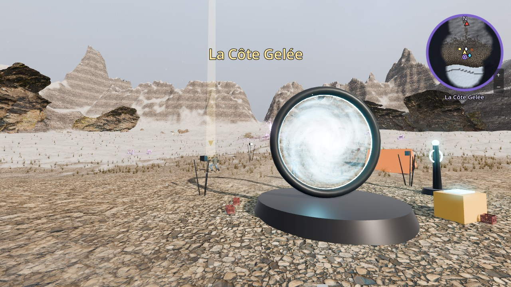
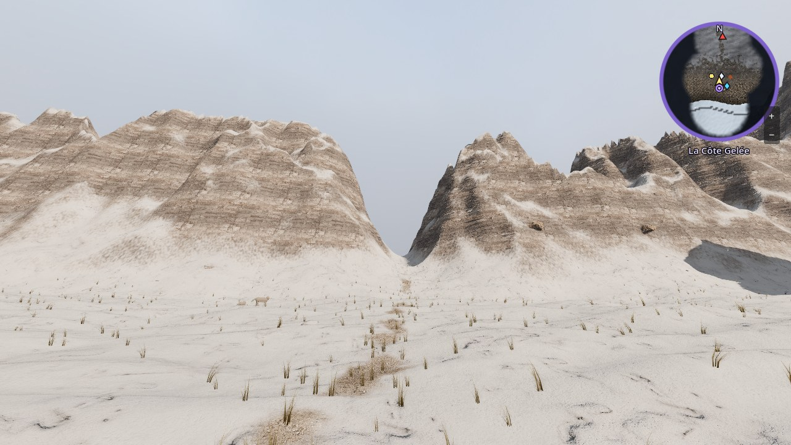
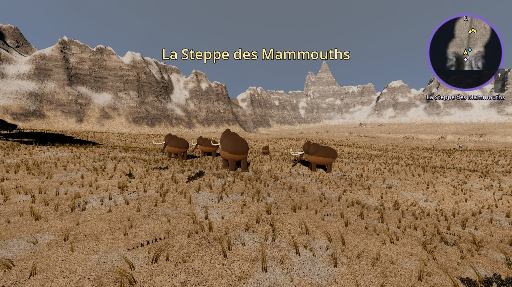
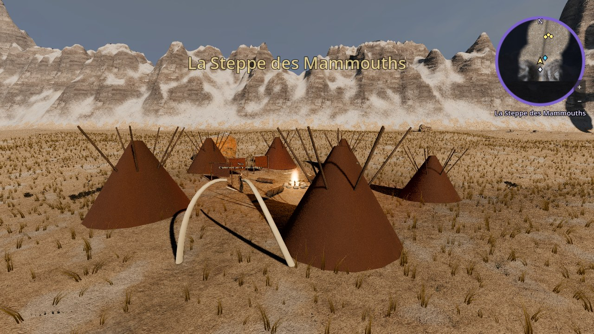
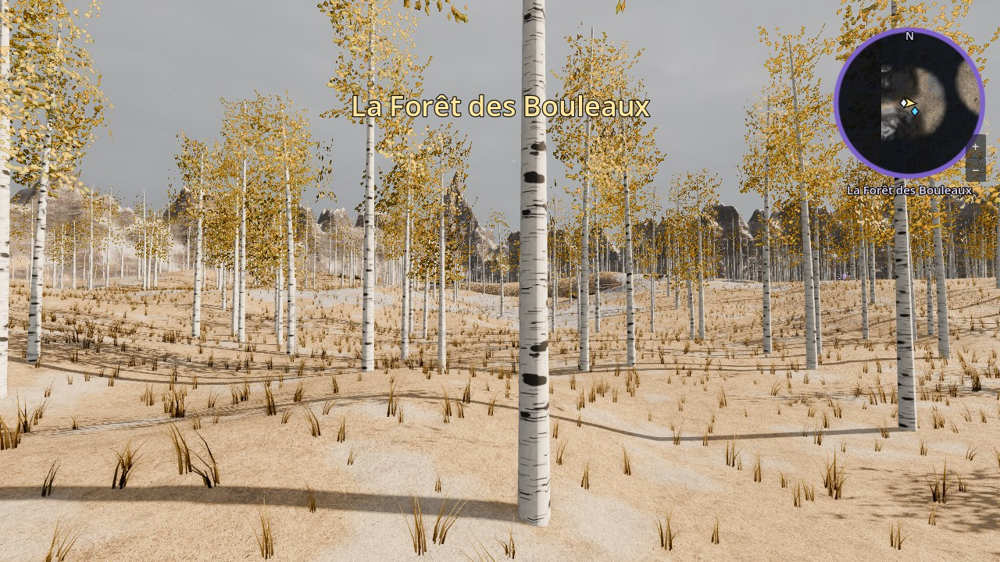
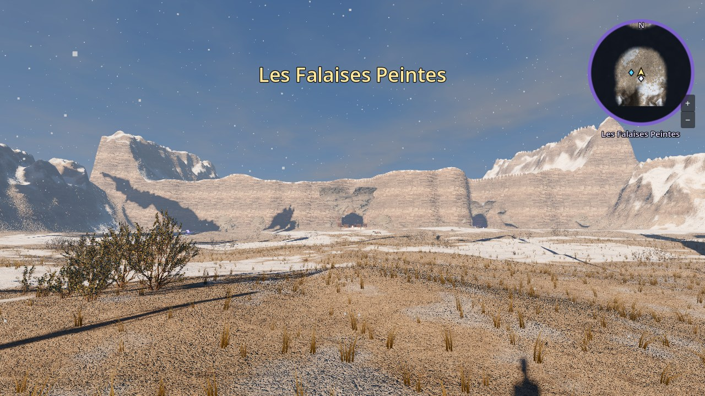
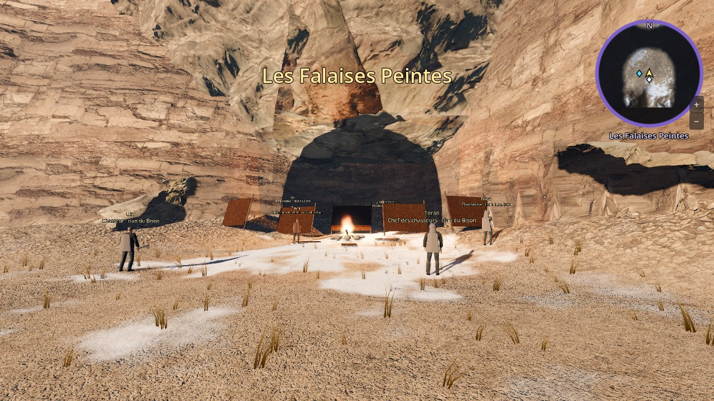

# Visiter la Préhistoire : Côte Gelée, Steppe des Mammouths, Forêt des Bouleaux, Falaises Peintes

La première zone de l'île de la Préhistoire est jouable : **la Côte Gelée** (niveaux 1 à 3), il y a environ 17 000 ans, en pleine période glaciaire. C'est là que mène le portail de la Préhistoire du QG de la Vigie.

On y trouve une crique de galets entre deux falaises de calcaire, une mer glaciale où flottent des plaques de glace et des icebergs, un plateau enneigé couvert d'herbe sèche qui monte vers le nord, des rochers et du bois mort, le squelette d'un mammouth à moitié enfoui, et le camp de la Vigie autour du portail (tente arrachée, caisses renversées, projecteurs). Au nord du camp, une **faille** violette déchire l'air.

Les textures (galets, neige, terre gelée, falaises), les rochers scannés, le bois mort et le ciel viennent de **Poly Haven** (gratuits, licence CC0). Le reste (relief, mer, glace, squelette, faille) est fabriqué par le code.





## L'ouvrir

1. Dans GitHub Desktop, sur la branche **main** : **Fetch origin** puis **Pull origin** (Claude le fait pour toi quand il le peut).
2. **Ferme Godot et rouvre-le** si il était ouvert pendant la mise à jour (ou menu **Projet → Recharger le projet actuel**). La première ouverture importe les nouvelles images : ça peut prendre une ou deux minutes.
3. **Par le jeu** : F5, **Jouer seul**, puis au QG de la Vigie, traverse le portail de la Préhistoire.
4. **Directement** : double-clique sur `scenes/monde/prehistoire/cote_gelee.tscn` puis **F6**.

Pour revenir à Hikari Bay : éloigne-toi un peu du portail, puis retraverse-le. Tu arrives devant le portail du QG.

## Le chapitre 1 : « Arrivée dans le froid »

Un **objectif** en haut de l'écran et une **flèche dorée** te guident :

1. retrouver l'**agent Lenoir**, blessé près du portail (touche **F** pour parler) ;
2. ramasser la **trousse de soin** près des caisses renversées ;
3. **soigner Lenoir** (F, puis rester immobile 3 secondes) ; il explique les règles et le combat ;
4. éliminer les **4 loups fracturés** (veines violettes) qui rôdent autour du camp : **Tab** pour viser, **1 à 5** pour frapper ;
5. retourner voir Lenoir ;
6. **refermer la faille** (F, rester immobile 5 secondes, sans se faire toucher) : deux loups en sortent, il faut d'abord s'en occuper ;
7. faire son rapport à Lenoir.

Le chapitre 2 commence : suivre la piste jusqu'au **col**, au nord. Passer le col mène à la **Steppe des Mammouths**. Des loups sauvages vivent aussi sur le plateau.

L'avancement est gardé : si tu quittes le jeu, tu reprends là où tu en étais. Pour recommencer la quête : clique sur le nœud **Quete** de la scène et coche **Toujours recommencer**.

## La Steppe des Mammouths (zone 2)

Derrière le col s'ouvre une grande plaine d'herbe sèche, froide et venteuse, entourée de montagnes enneigées. Une **rivière** la traverse d'ouest en est ; on la passe à pied au **gué** (l'eau n'y monte qu'aux chevilles). Un **troupeau de mammouths** broute à l'ouest, des **rennes** paissent sur la pente à l'est, et le **camp d'été du clan du Bison** (tentes en peaux, grand feu, séchoirs, arche en défenses de mammouth) est installé au nord de la rivière.

Pour l'ouvrir directement : `scenes/monde/prehistoire/steppe.tscn` puis **F6**. Pour revenir à la Côte Gelée : redescends par le col, au sud.





### Chapitre 2 : « Le Venu-du-Brouillard »

1. rejoindre la partie de chasse de **Toran**, juste après le col : il se méfie de toi ;
2. **chasser trois rennes** avec ses chasseurs, Ulm et Naya (les rennes s'enfuient quand on approche : il faut les rattraper) ;
3. retourner voir Toran, qui te donne **sa lance à pointe de silex** ;
4. traverser la rivière par le gué et rejoindre le **camp d'été**.

### Chapitre 3 : « Le rêve d'Aïna »

1. écouter **Aïna**, la chamane, qui rêve de « lumières qui mangent les images » ;
2. récolter **3 veines d'ocre rouge** sur la berge nord, à l'ouest du gué (F, rester immobile un instant) ;
3. prendre du **charbon** dans le vieux foyer des chasseurs, au nord-est ;
4. détacher **2 morceaux de pierre noire** (manganèse) dans les rochers du nord-ouest, gardés par des loups fracturés ;
5. rapporter les pigments à Aïna : elle peint une **main** sur la paroi du camp et te donne de l'**ocre sacrée**.

Au camp, tu peux aussi parler à **la Vieille Mère**.

## La Forêt des Bouleaux (zone 3)

À l'est de la steppe, une **passe** mène à une forêt clairsemée de bouleaux aux troncs blancs et aux feuilles dorées, sur des collines enneigées. Une rivière la traverse du nord au sud (un gué de pierres plates permet de passer). C'est le territoire des loups, et quatre **failles** y sont ouvertes, gardées par des fracturés. Les bouleaux sont fabriqués par le code (Poly Haven n'en a pas).



Pour l'ouvrir directement : `scenes/monde/prehistoire/foret.tscn` puis **F6**. Pour revenir à la steppe : la passe, à l'ouest.

### Chapitre 4 : « La louve grise »

1. au camp, **Toran** raconte que Kéo a suivi sa louve Grise vers l'est ;
2. passer à l'est, dans la Forêt des Bouleaux ;
3. **suivre les traces** de Kéo et de Grise dans la neige, jusqu'au gué puis à une clairière ;
4. Kéo est **encerclé par quatre loups fracturés** : les éliminer ;
5. parler à Kéo : Grise est contaminée par la faille ;
6. **le choix** : soigner Grise (rester immobile 8 secondes, deux loups viennent l'en empêcher : il faut d'abord s'en occuper) **ou** dire à Kéo de la laisser partir (elle s'enfuit). Les deux choix permettent de continuer, et le jeu s'en souvient : si Grise est soignée, elle est au camp à côté de Kéo ;
7. rentrer au camp et parler à **Aïna**.

### Chapitre 5 : « L'objet impossible »

1. Retourne au portail, sur la Côte Gelée, et raconte tout à l'agent Lenoir.
2. Repasse par la steppe jusqu'à la Forêt des Bouleaux et referme la grande faille au nord-ouest (des fracturés la gardent).
3. Là où était la faille, ramasse l'objet qui brille : une montre à gousset brisée, gravée « E. ».
4. Montre-la à Lenoir : quelqu'un d'autre voyage dans le temps. Passe le portail pour la rapporter au QG de la Vigie.

## Les Falaises Peintes (zone 4)

Au nord de la steppe, une **passe** mène à une vallée enneigée fermée par une immense **falaise de calcaire** en gradins. Au fond d'une anse de la falaise, l'**abri sous roche** du clan : un grand feu, des peaux tendues contre le vent, et sur la paroi les **peintures des ancêtres** (bisons, chevaux, points, signes). Plus à l'est, une lueur violette sort de l'entrée de la **Grande Grotte** : c'est là que se cache la fracture majeure (le futur donjon). Pour y aller directement : double-clique sur `scenes/monde/prehistoire/falaises.tscn` puis **F6**.





### Chapitre 6 : « L'hiver qui vient trop tôt »

1. Lenoir, au portail, annonce une tempête anormale au nord. Rejoins le camp d'été : la neige et le brouillard tombent sur la steppe.
2. Aïna décide de partir pour les **Falaises Peintes**, l'abri d'hiver. Toran est parti devant.
3. Escorte les familles (Aïna, la Vieille Mère, Naya, Kéo) jusqu'à la passe du nord. Elles n'avancent que si tu restes près d'elles, et des fracturés attaquent deux fois en route.
4. Aux Falaises Peintes, défends l'abri sous roche contre cinq fracturés, puis parle à Aïna : la tempête se calme… mais une peinture semble pâlir.

La suite (chapitre 7, « Les murs vides ») arrive dans une prochaine mise à jour.

## Ce que tu peux régler toi-même

- **Les textes** (objectifs, dialogues de Lenoir, Toran, Aïna…, textes d'arrivée) : `game/data/prehistoire_quete.json` et `game/data/prehistoire_pnj.json`.
- **Les camps d'ennemis** (position, nombre, type) : section `camps` de `game/data/prehistoire_quete.json`.
- **Les loups fracturés** (vie, dégâts, vitesse, réapparition) : `game/data/ennemis.json`, entrées `loup_fracture` et `loup_fracture_faille`, et les **rennes** (`renne`).
- **Les tenues du clan** : `tenue` de chaque personnage dans `game/data/prehistoire_pnj.json` (des objets de `game/data/objets.json`).
- Dans l'**Inspecteur**, nœud **CoteGelee** : la **graine** (autre relief), le **nombre de touffes** d'herbe (à baisser si le jeu rame), la **neige qui tombe**, et le **ciel** (essaie `table_mountain_1_puresky` pour une aube nuageuse ou `snow_field_2_puresky` pour un ciel couvert). Le bouton **Reconstruire l'île** refait tout.

## Le tester automatiquement

```
godot --headless --path game -s res://tests/test_cote_gelee.gd
```

```
godot --headless --path game -s res://tests/test_steppe.gd
godot --headless --path game -s res://tests/test_foret.gd
godot --headless --path game -s res://tests/test_chapitre5.gd
godot --headless --path game -s res://tests/test_falaises.gd
```

Le premier test parcourt tout le chapitre 1 (Lenoir, trousse, soins, fracturés, faille, rapport), vérifie que l'avancement est gardé, que le col mène à la Steppe et que le portail ramène au hub. Le second parcourt les chapitres 2 et 3 dans la Steppe (Toran, chasse, gué, Aïna, pigments, main peinte) et le retour par le col. Le troisième joue le chapitre 4 deux fois (Grise soignée, puis Grise libérée). Le quatrième joue le chapitre 5 (faille de la forêt, montre, retour au portail). Le cinquième joue le chapitre 6 (tempête, escorte, défense de l'abri) et vérifie les Falaises Peintes.

## Ce qui viendra ensuite

- Le chapitre 7 (« Les murs vides ») et le donjon de la **Grande Grotte** (chapitre 8).
- De vrais modèles animés pour les loups, rennes et mammouths (pour l'instant des silhouettes simples), et de vrais vêtements de peau pour le clan.
- Des sons : vent, vagues, craquements de la glace.
