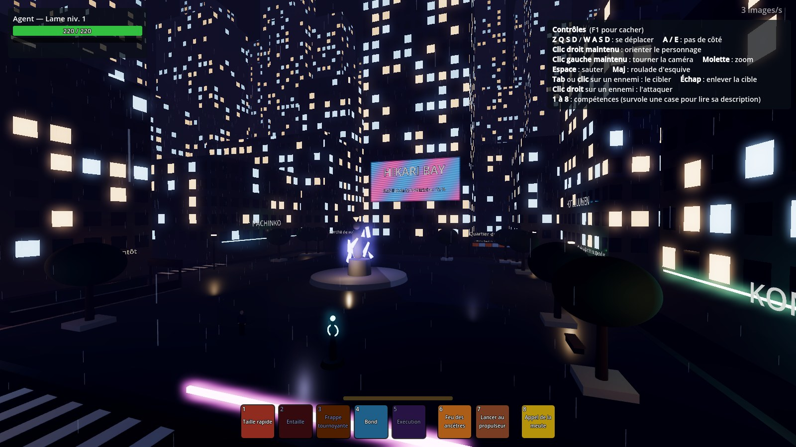

# Visiter la Place Hikari (hub, maquette de blocs)

La première partie du hub Hikari Bay est jouable : la **Place Hikari**, l'escalier de la **station Asahi** qui descend vers la porte du QG, la rue qui mène au **front de mer**. Le plan complet de la ville est dans [docs/HUB.md](../HUB.md).

Les décors deviennent réalistes : sol pavé mouillé avec des flaques, façades en béton, mobilier urbain (lampadaires, bacs plantés, bornes à incendie, climatiseurs, rideaux de fer, blocs de béton de chantier) et enseignes en japonais, anglais et français. Les textures et modèles viennent de **Poly Haven** (gratuits, licence CC0). Les immeubles restent des volumes simples avec des fenêtres calculées : ils seront détaillés plus tard.

## L'ouvrir

1. Dans GitHub Desktop, sur la branche **main**, clique sur **Fetch origin** puis **Pull origin** (Claude le fait pour toi quand il le peut).
2. **Si Godot était ouvert pendant la mise à jour**, ferme-le et rouvre-le (ou menu **Projet → Recharger le projet actuel**) : sinon il ne connaît pas les nouveaux fichiers.
3. Appuie sur **F5** (« Lancer le projet »), puis **Jouer seul** : tu arrives à Hikari Bay.
4. Pour tester seulement la ville sans passer par le menu : double-clique sur `scenes/monde/hikari_bay.tscn` puis **F6**.

**Jouer à plusieurs** : un joueur clique sur **Héberger**, les autres sur **Rejoindre** avec son adresse. « Rejoindre » seul ne marche pas : il faut qu'une partie soit hébergée.

## L'introduction (environ 5 minutes)

La première fois, un écran noir présente Hikari Bay, puis un **objectif** en haut de l'écran et une **flèche dorée** te guident :

1. parler à **Kenji Duval**, près de la fontaine (touche **F**) ;
2. descendre l'escalier de la **station Asahi** ;
3. parler à la **commandante Morel** dans le Hall des opérations ;
4. parler à **Yuki Tanabe** dans la salle des portails ;
5. traverser le **portail de la Préhistoire** : tu pars sur l'île.

Ensuite l'intro ne se rejoue plus. Pour la revoir : clique sur le nœud **Intro** de la scène et coche **Toujours rejouer** dans l'Inspecteur. Tous les textes sont dans `game/data/hub_intro.json` (modifiables sans code). Le voyage par portail se fait en solo pour l'instant ; en groupe, il arrive bientôt.

## Le Quartier des Artisans

La rue du nord-est de la place mène au **Quartier des Artisans** : d'anciens entrepôts sous le **métro aérien** (une rame passe régulièrement). Deux ateliers se visitent :
- la **forge Hinode**, avec son four rougeoyant, Maître Tetsuo et son apprentie ;
- l'atelier **Fil & Fibre**, moitié couture, moitié impression 3D (Léa et Kofi).

## Le Musée et les Jardins suspendus

La rue de l'est de la place mène à une grande **esplanade** : un bassin, des **super-arbres** lumineux reliés par une passerelle, deux **terrasses plantées** (on y monte par les marches) et la **Cascade des Souvenirs**. Au fond, le **Musée de verre** se visite : la salle Préhistoire montre trois objets en vitrine et un mur de **fresques**, effacées tant que la Préhistoire est malade. Elles reviennent quand l'époque est réparée. Les autres salles sont fermées (« époque instable »).

## Le Front de mer

La rue du sud de la place descend jusqu'à la **promenade** au bord de la baie : platelage en bois, bancs face à la mer, guirlandes d'ampoules et un stand de takoyaki. Deux jetées partent du quai :

- la jetée du **Terminal des ferries** (compagnie « Vigie Lines », en réalité une façade de la Vigie). On entre dans le terminal : guichets, tableau des départs (les « destinations » sont les époques) et baie vitrée sur la mer. Le ferry *Hikari Maru* est à quai, mais il ne part plus ;
- la jetée de la **grande roue**, fermée pour maintenance.

## Les Résidences

La rue de l'ouest de la place mène au quartier d'habitation. Autour d'une petite place, on trouve un parc avec un **cerisier en fleurs** (hors saison...), des balançoires et des distributeurs de boissons. Trois lieux se visitent :

- le **konbini Hoshi**, ouvert 24 h/24 : rayons, frigos lumineux, caisse ;
- le hall de la **Résidence Sakura** : boîtes aux lettres et ascenseurs (les appartements des joueurs viendront plus tard) ;
- la **Maison des guildes** : bannières, grande table et registre (la fondation des guildes viendra plus tard).

## L'Arène de la baie

Au bout est de la promenade, un quai en bois mène à une plateforme posée sur l'eau : l'**Arène**, un stade circulaire en pleine rénovation (échafaudages, projecteurs, grand écran). On entre sur le terrain par l'ouest. Les combats entre joueurs (JcJ) y auront lieu plus tard.

## Le Marché de nuit et les missions secondaires

La rue du nord-ouest de la place mène au **Marché de nuit** : trois ruelles étroites avec des stands de nourriture, des lanternes rouges et des enseignes empilées. Deux bâtiments se visitent :
- le restaurant de ramen **Kaminari** (ruelle principale), avec le chef Goro et ses clients ;
- la **salle Tsukimi** (ruelle de la fumée), le futur hôtel des ventes.

Des habitants proposent des **missions secondaires** : un **« ! »** doré flotte au-dessus d'eux. Parle-leur avec **F**. La mission en cours s'affiche en haut à gauche, un **« ? »** montre qui aller voir, et des flèches dorées montrent les objets à trouver. La touche **J** ouvre le journal des missions.

| Mission | Où la trouver |
|---|---|
| Kuro a disparu | Madame Sato, sur la place (côté nord-ouest) |
| Un bol pour la route | Le chef Goro, dans le restaurant Kaminari |
| L'écran qui grésille | Nina, sous l'écran géant |
| Ferraille temporelle | Maître Tetsuo, à la forge Hinode (Artisans) |
| Une louche sur mesure | Kofi, à l'atelier Fil & Fibre (Artisans) |
| Les fresques effacées | La Dr Diallo, à l'accueil du Musée |
| L'eau des jardins | M. Tan Wei, sur la terrasse nord des Jardins suspendus |
| Les lanternes de la baie | Grand-mère Ume, sur la promenade du Front de mer |
| Billet pour nulle part | Rina, au guichet du Terminal des ferries |
| Courrier égaré | Madame Fujimoto, dans le hall de la Résidence Sakura |
| Trois signatures | Aleksander, à la Maison des guildes |
| Lumière sur l'Arène | Kenta, l'électricien, sur le terrain de l'Arène |
| Tête d'affiche | DJ Volt, sur le quai de l'Arène |
| L'objet impossible | Commence tout seul quand tu reviens de la Côte Gelée avec la montre à gousset : visite guidée du QG |

Tous les textes des missions sont dans `game/data/hub_quetes.json`, et ceux des habitants dans `game/data/hub_pnj.json`.

## Ce qu'on peut y faire

- Se promener sur la place, sous la pluie, au milieu des néons.
- Descendre l'escalier de la **station Asahi** (coin sud-ouest de la place) : la porte blindée s'ouvre sur le **QG de la Vigie** (hall, coffre, entraînement, portails).
- Descendre la rue du sud jusqu'au **front de mer** : la grande roue, et au large, la lumière de l'île de la Préhistoire.
- Tous les quartiers prévus sont ouverts. Seul le bout ouest de la promenade reste fermé par une barrière de chantier.

## Ce que tu peux régler toi-même

Clique sur le nœud **HikariBay** (tout en haut de la liste des nœuds) et regarde l'**Inspecteur** à droite :

| Réglage | Effet |
|---|---|
| **Prehistoire Reparee** | Coche-le : les éclats de fracture autour de la statue disparaissent et les fresques du Musée reviennent. C'est un premier essai de « la ville qui change ». |
| **Pluie** | Décoche-le si le jeu rame. |
| **Gouttes** | Nombre de gouttes de pluie. |
| **Reconstruire la place** | Bouton qui refait toute la maquette. |

Pour les couleurs du ciel, du brouillard et de la lumière ambiante : nœud **Environnement**, puis la ressource *Environment* dans l'Inspecteur.
